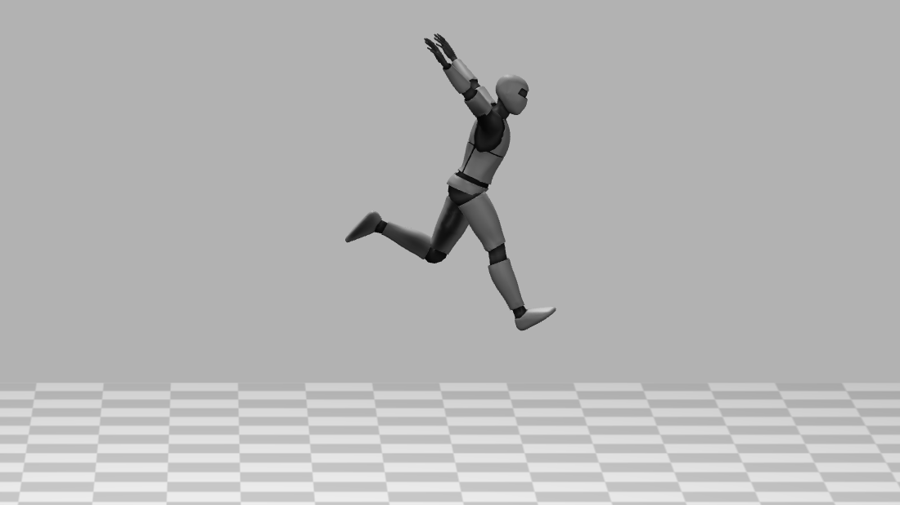

# Stunt Double

**A physics stand-in for animation and AI video, by [Ari Shapiro](https://github.com/arishapiro).**

Direct a simulated character through falls, swings, hits and landings. Then send the motion,
camera and control passes to Blender, Unity, Unreal or a video model for the final look.

### [⬇ Download for Windows](https://github.com/arishapiro/StuntDouble/releases/latest)

Free to use, including for commercial work. What you make with it is yours.

## What it does

- **Physically simulated characters.** A full-body skeleton driven by physics (MuJoCo), with
  joint limits, collisions and controllers that balance, fall, jump, walk, get up and reach.
- **Stunts.** Falls from heights, down stairs and onto tables; car crashes with and without
  seat belts; wrecking balls, trapezes, rope swings and monkey bars; safety nets and crash mats.
- **A damage meter.** Every blow is measured, part by part, so you can compare a fall limp
  against a fall braced, or a bare floor against a crash mat.
- **Motion capture.** Load BVH or ASF/AMC motion (CMU, Mixamo and others), retarget it onto the
  character, and let physics take over when something hits it.
- **Export.** FBX for Blender, Unity and Unreal, with standard joint names (Mixamo, the Unreal
  mannequin, Unity's humanoid) so it retargets straight onto your rig.
- **Control passes for AI video.** Depth, normals, masks, body parts and OpenPose skeletons,
  frame by frame from the same camera, plus the camera itself: what ControlNet and video
  models such as Wan VACE take, to turn a simulated stunt into a photorealistic shot.
- **Movies.** Render H.264 MP4, PNG frames or GIFs at any size and frame rate, with no other
  software needed.
- **Python scripting.** Every scene is a Python script you can change, with more than 40 tutorial
  scenes to start from.

| | |
|---|---|
|  |  |
| A wrecking ball | Chained together: one falls and pulls the other off the ledge |
|  |  |
| A falling elevator | Pose control and collisions |

## Install

1. Download `StuntDouble-<version>-setup.exe` from the
   [latest release](https://github.com/arishapiro/StuntDouble/releases/latest).
2. Run it. It installs for your user account, so it doesn't need administrator rights.
3. Start **Stunt Double** from the Start menu, then open a scene from **Scripts > tutorials**.

**"Windows protected your PC"?** The installer isn't code-signed yet, so Windows SmartScreen
may stop it the first time. Click **More info**, then **Run anyway**.

**Requirements:** Windows 10 or 11, 64-bit, and a graphics card with OpenGL. Python 3.14,
MuJoCo and everything else it needs are included (about 42 MB to download).

**To learn it:** the Start menu has the tutorial scenes, a step-by-step tutorials guide
(Markdown and PDF, with screenshots) and the manual.

**Updates:** once a day, Stunt Double checks here for a new version and tells you if there is
one. It sends nothing about you or your computer, and never installs anything by itself. To turn
it off, uncheck **Help > Check for updates automatically**.

**To uninstall:** Settings > Apps, or **Uninstall Stunt Double** in the Start menu.

## Feedback

Found a bug or want a feature? [Open an issue](https://github.com/arishapiro/StuntDouble/issues).

## License

Stunt Double is free to use, personal or commercial, under its
[End User License Agreement](EULA.txt). It includes software and data from others under their
own licenses, listed in [THIRD_PARTY_NOTICES.txt](THIRD_PARTY_NOTICES.txt). Some of the sample
motion capture (the Bandai Namco clips) is licensed for noncommercial use only.

Stunt Double is built with DANCE (Dynamic ANimation and Control Environment), which is governed
by its own license terms.

© 2026 Ari Shapiro
