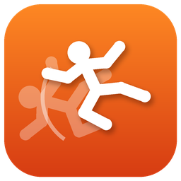
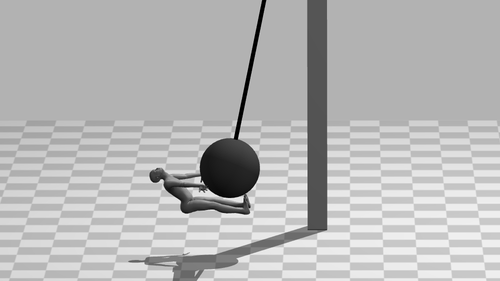
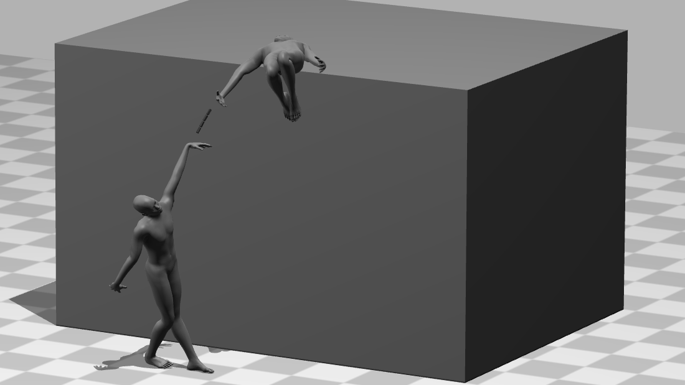
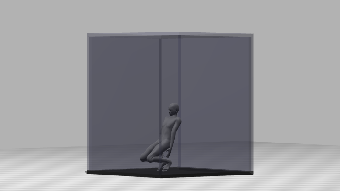
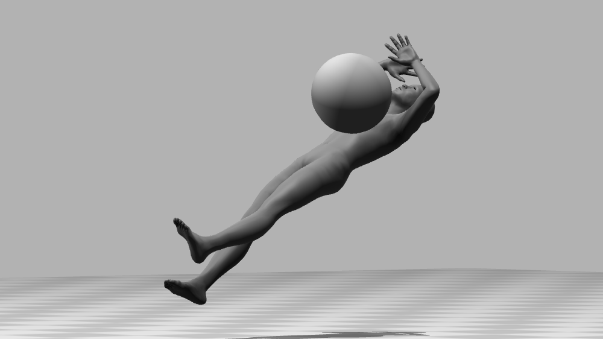

# Stunt Double

**A physics stand-in for animation and AI video, by [Ari Shapiro](https://github.com/arishapiro).**

Direct a simulated character through falls, swings, hits and landings. Then send the motion,
camera and control passes to Blender, Unity, Unreal or a video model for the final look.

### [⬇ Download for Windows, macOS or Linux](https://github.com/arishapiro/StuntDouble/releases/latest) · [Read the tutorials](docs/tutorials/README.md)

Free to use, including for commercial work. What you make with it is yours.

## What it does

Under the hood is a physics simulation. What Stunt Double adds is everything a stunt needs on
top of it:

- **Characters that act, not just ragdolls that fall.** A full-body skeleton with joint limits
  and collisions, and controllers that balance, walk, jump, fall, get up, kip up and reach, or
  windmill the arms in the air to turn and land flat. A master controller switches between
  them, and learned controllers track motion capture and fall well.
- **Stunts ready to run.** More than 40 tutorial scenes, each a whole setup: hit by a car with
  and without a seat belt, down the stairs, onto a table, an elevator falling down its shaft, a
  wrecking ball, a trapeze, monkey bars, a rope swing, a heavy bag, a safety net, a crash mat.
  Windshields break, hands grip bars, and anything can be fastened to anything.
- **A score for every take.** The damage meter measures every blow, part by part, and how far
  each joint was forced past its limits, so takes can be compared: the same tumbling fall
  scores 2700 limp onto bare ground, 52 limp onto a safety net, and 6.1 windmilling in the air
  to land flat on the net.
- **Motion capture.** Load BVH or ASF/AMC motion (CMU, Mixamo and others), retarget it onto the
  character, and let physics take over when something hits it.
- **Export.** FBX for Blender, Unity and Unreal, with standard joint names (Mixamo, the Unreal
  mannequin, Unity's humanoid) so it retargets straight onto your rig.
- **Control passes for AI video.** Depth, normals, masks, body parts and OpenPose skeletons,
  frame by frame from the same camera, plus the camera itself: what ControlNet and video
  models such as Wan VACE take, to turn a simulated stunt into a photorealistic shot.
- **Movies.** Render H.264 MP4, PNG frames or GIFs at any size and frame rate, with no other
  software needed.
- **Hands on.** Every scene is a Python script you can change, timed events run on a timeline,
  each controller has a panel of settings, and Ctrl+drag in the view grabs any part of the body
  and throws it.

| | |
|---|---|
|  |  |
| A wrecking ball | Chained together: one falls and pulls the other off the ledge |
|  |  |
| A falling elevator | Pose control and collisions |

## Install

Download from the [latest release](https://github.com/arishapiro/StuntDouble/releases/latest):
the installer or zip for Windows, the `.dmg` for macOS, or the AppImage for Linux. They all have
the same program inside, with Python 3.14 and everything else it needs. Then open a scene from
**Scripts > tutorials**.

**Requirements:** a graphics card with OpenGL, and one of:

- Windows 10 or 11, 64-bit
- an Intel Mac with macOS 11 (Big Sur) or later. Apple Silicon Macs should run it through
  Rosetta 2, though that hasn't been tested yet.
- 64-bit Linux from 2022 or later (Ubuntu 22.04 or later, and similar)

### Windows

1. Download `StuntDouble-<version>-setup.exe` (about 59 MB).
2. Run it. It installs for your user account, so it doesn't need administrator rights.
3. Start **Stunt Double** from the Start menu.

**Rather not install it?** Download `StuntDouble-<version>-win64.zip` (about 75 MB) instead,
right-click it, choose **Extract All**, and run `Stunt Double\bin64\dance.exe`. Extract it first
(it won't run from inside the zip), and somewhere you can write to, such as Desktop, Documents
or Downloads, not Program Files: Stunt Double keeps its settings and recordings in its own folder.

**"Windows protected your PC"?** Stunt Double isn't code-signed, so Windows SmartScreen may
stop it the first time, whether that's the installer or `dance.exe` from the zip. Click
**More info**, then **Run anyway**.

**To uninstall:** Settings > Apps, or **Uninstall Stunt Double** in the Start menu. From the
zip, delete its folder.

### macOS

1. Download `StuntDouble-<version>-macOS.dmg` (about 89 MB).
2. Open it and drag **Stunt Double** onto **Applications**.
3. Stunt Double isn't signed by Apple, so the first time, right-click it in Applications and
   choose **Open**, then **Open** again. If macOS only offers to move it to the Trash, open
   **System Settings > Privacy & Security** and click **Open Anyway** next to Stunt Double.

On its first run it copies itself to `~/Library/Application Support/StuntDouble/<version>` and
runs from there, since Stunt Double keeps its settings and recordings in its own folder.

**To uninstall:** drag it from Applications to the Trash, and delete
`~/Library/Application Support/StuntDouble`.

### Linux

1. Download `StuntDouble-<version>-x86_64.AppImage` (about 81 MB).
2. Make it executable and run it:
   `chmod +x StuntDouble-<version>-x86_64.AppImage`, then `./StuntDouble-<version>-x86_64.AppImage`.

On its first run it copies itself to `~/.local/share/StuntDouble/<version>` and runs from
there. If it won't start, install FUSE 2 (`sudo apt install libfuse2t64`, or `libfuse2` on
Ubuntu 22.04), or run it with `--appimage-extract-and-run`.

**To uninstall:** delete the file and `~/.local/share/StuntDouble`.

### Then

**To learn it:** work through the [step-by-step tutorials](docs/tutorials/README.md), here
or in the program's `docs/tutorials` folder (Markdown and PDF, with screenshots). On Windows
the Start menu also has the tutorial scenes and the manual.

**Updates:** once a day, Stunt Double checks here for a new version and tells you if there is
one. It sends nothing about you or your computer, and never installs anything by itself. To turn
it off, uncheck **Help > Check for updates automatically**.

## Feedback

Found a bug or want a feature? [Open an issue](https://github.com/arishapiro/StuntDouble/issues).

## License

Stunt Double is free to use, personal or commercial, under its
[End User License Agreement](EULA.txt). It includes software and data from others under their
own licenses, listed in [THIRD_PARTY_NOTICES.txt](THIRD_PARTY_NOTICES.txt). Some of the sample
motion capture (the Bandai Namco clips) is licensed for noncommercial use only.

Stunt Double is built with DANCE (Dynamic ANimation and Control Environment), which is governed
by its own license terms.

© 2026 Ari Shapiro
