# Stunt Double Tutorial 1: The Basics

Nov 9, 2026 · @Ari

## Before you start

In about 20 minutes you will drop a ragdoll character, re-pose it, launch it with a starting velocity, measure how badly it gets hurt, and hang it from one hand. Every step builds on the same scene, so work through them in order.

**Open the scene:** choose **Scripts > tutorials > Tutorial\_01\_Ragdoll**. You get one character, a human, standing on a ground plane under gravity. He has only a trace of muscle tone, so he falls like a ragdoll.

**The one rule to remember:** change the starting setup only after **Stop**, then **Reset**. If you rewind and change the pose without resetting, Play throws the change away and starts from the old recording.

## 1. The interface: simulate, stop, rewind, simulate again

The main window has seven areas. You will use all of them in this tutorial.

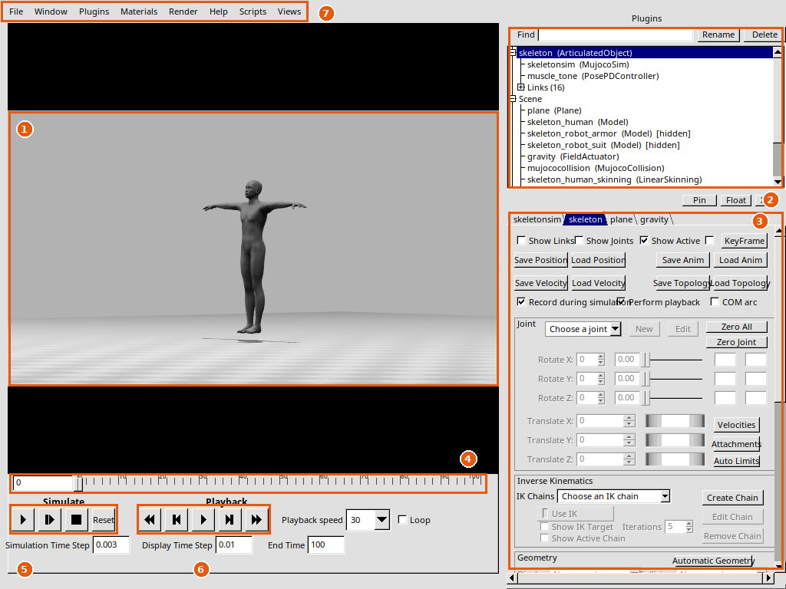

*Figure 1. The main window with Tutorial 1 loaded.*

1. **3D view.** The scene. Camera: **Alt + left-drag** orbits, **Alt + middle-drag** pans, **right-drag** zooms. Small drags go a long way.
2. **Plugins tree.** Everything in the scene: the character (skeleton), its simulator (skeletonsim), its muscle tone (muscle\_tone), its skins, the ground plane, gravity. Click an item to open its panel.
3. **Object panel.** One tab per object. The **skeleton** tab poses the character; the **skeletonsim** tab holds the simulator settings.
4. **Time slider.** Shows the time. After a run, drag it to scrub through the recorded motion.
5. **Simulation controls.** Play / Pause, Step, Stop and Reset.
6. **Playback controls.** Replay the motion you just recorded, without simulating again.
7. **Menu bar.** Scripts loads the tutorials; Window > Show-Hide Command Console opens the console.

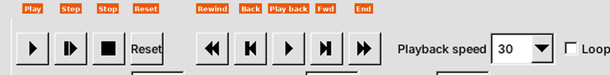

*Figure 2. The simulation controls (left) and playback controls (right).*

### Simulate

1. Press **Play**. He crumples to the ground within about a second. Play turns into **Pause** while it runs.

   He isn't completely limp: **muscle\_tone**, a pose controller set very weak, keeps him from folding up quite as far as a rag doll would. Its strength is the `stiffness` setting at the top of the Tutorial\_01\_Ragdoll script (0 for none).
2. Press **Stop**. The run is recorded up to the moment you stopped.

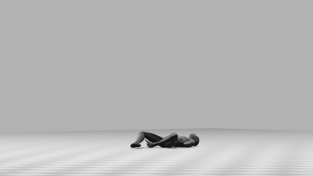

*Figure 3. After the fall.*

### Rewind and scrub

1. Press **Rewind** to jump back to 0 s, then **Play back** to watch the recording.
2. Or drag the time slider to any moment. Here it is at 0.68 s, halfway down.

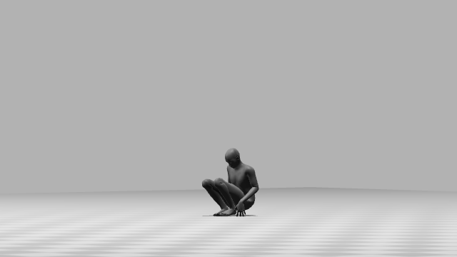

*Figure 4. Scrubbing the recording to 0.68 s.*

Playback only replays what was recorded. Nothing is simulated again.

### Simulate again

1. Press **Reset** and answer **Yes**. This erases the recording and puts the skeleton back where it was at 0 s.
2. Press **Play**.

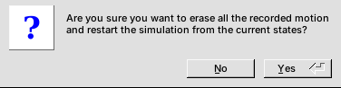

*Figure 5. Reset asks before it erases the recording.*

Reset is also the step before every change in the rest of this tutorial: **Stop, Reset, change, Play.**

## 2. Move the hip: start the fall from higher up

The **Hip** is the skeleton's root joint. It is a free joint ("Free XYZ"), so moving it moves the whole body. Here you lift him 1.9 m and tip him back 30° before the fall.

1. Stop and Reset (Section 1).
2. Open the **skeleton** tab. Under **Joint**, choose **Hip**.
3. In **Translate Y**, type `3.0` and press Enter. Standing height is 1.131 m, so this lifts him about 1.9 m off the ground.
4. In **Rotate X**, type `30` and press Enter. He tips back 30° about the X axis.
5. Press **Play**. He drops from the new height, leaning back.

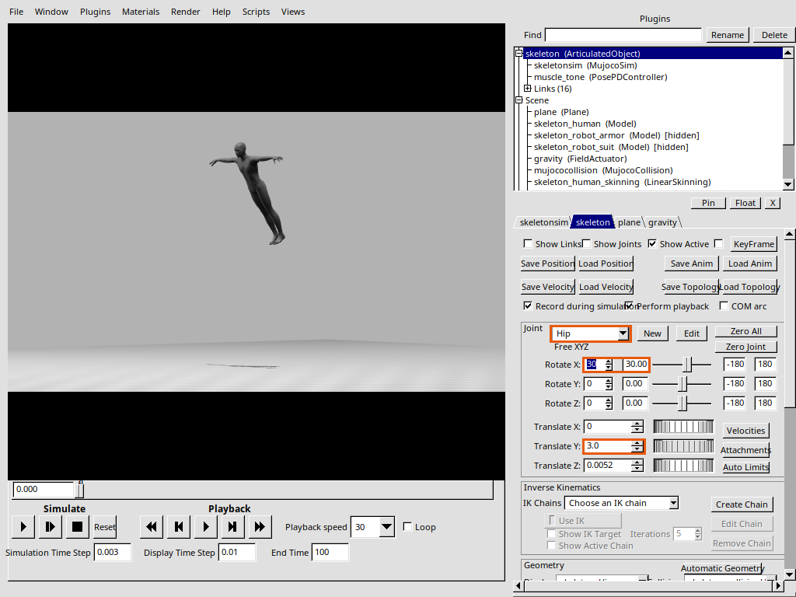

*Figure 6. The Hip selected, with Translate Y at 3.0 and Rotate X at 30.*

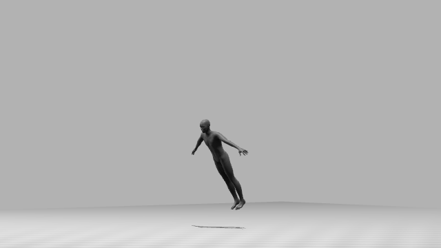

*Figure 7. Falling from the new starting pose (0.58 s).*

Translate values are in metres and rotations in degrees. The same panel poses any other joint: pick it from the Joint list and change its rotations.

## 3. Pose him with IK

Inverse kinematics (IK) lets you drag a hand or foot to where you want it, and the joints of that limb follow. Here you raise his left hand above his head.

1. Stop and Reset.
2. On the **skeleton** tab, under **Inverse Kinematics**, choose **left arm** from **IK Chains**. The skeleton comes with chains for each arm and leg, "with body" versions that also bend the trunk, and the head.
3. Click **Use IK**. Its light turns green.
4. Tick **Show IK Target** and **Show Active Chain**. The arm's chain is drawn in blue, faintly through the skin (the Bones look in Section 7 shows it fully).
5. Left-drag in the 3D view. The hand follows the mouse; drag it up above his head.
6. Click **Use IK** again to turn it off.
7. Press **Play**. He falls with the arm raised.

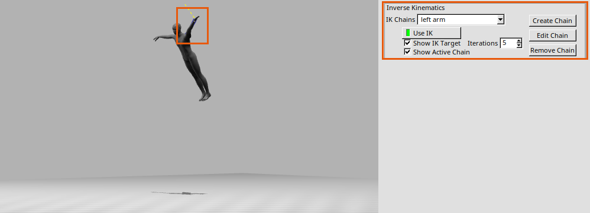

*Figure 8. The left arm raised with IK (outlined), and the IK settings.*

- IK works only while the simulation is stopped.
- While Use IK is on, it takes over the mouse in the 3D view, so the camera won't move. Turn it off when you are done posing.
- **Iterations** sets how hard IK tries to reach the mouse on each move; raise it if the hand lags behind.
- The Joint fields above the IK section may not update after a drag.

## 4. Launch him: initial velocity and the centre of mass arc

An initial velocity on the Hip launches the whole body when the simulation starts. The centre of mass (COM) arc previews where he will go before you press Play.

1. Stop and Reset.
2. On the **skeleton** tab, choose **Hip** under Joint and click **Velocities**. The **Set Velocities** window opens.
3. In the **Initial** column, set **Linear Vel X** to `3` and **Linear Vel Y** to `4`. That is 3 m/s sideways and 4 m/s up.
4. Tick **COM arc**. Three things appear in the view:
   - an orange dot at the centre of mass;
   - a yellow arrow for its velocity (the distance it covers in 0.25 s);
   - an orange arc: the path the centre of mass would follow under gravity alone, down to the ground.
5. Change the numbers and watch the arc move as you type. Then click **Set and Close**.
6. Press **Play**. He flies along the arc and lands about where it ends.

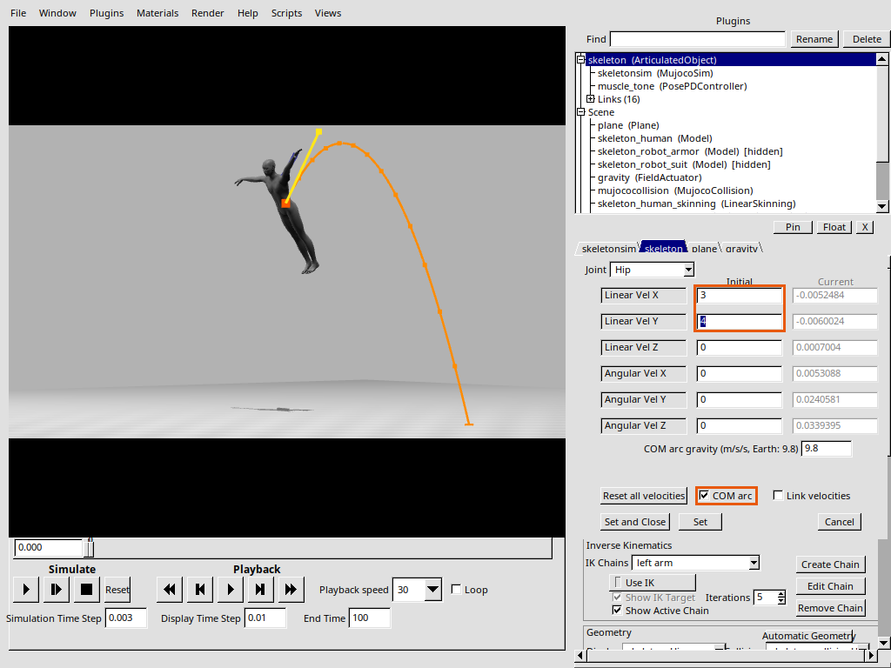

*Figure 9. 3 m/s sideways and 4 m/s up on the Hip, with the COM arc shown.*

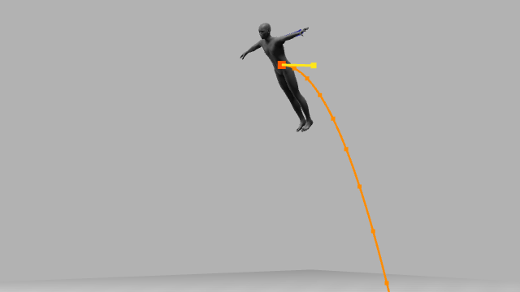

*Figure 10. In flight, 0.42 s in: the arc is redrawn from his velocity at that moment.*

- The **Current** column shows the velocity right now and is read-only. You set velocities in **Initial**.
- The angular rows spin him. They are in radians per second.
- **COM arc gravity** changes the gravity the preview uses: 9.8 m/s² is Earth and 1.62 m/s² is the Moon. It doesn't change the simulation's gravity.
- **Link velocities** draws an arrow for every body part.
- **Reset all velocities** sets every initial velocity back to zero.

## 5. Show the damage

The damage meter measures how hard each body part is hit. Parts glow over his body: yellow for a little damage, red for a lot, with a white flash at the moment of a hit.

1. Stop and Reset.
2. Open the **skeletonsim** tab and tick **Damage meter**. **Show damage** is on by default.
3. Press **Play**. Watch the parts light up as he lands.

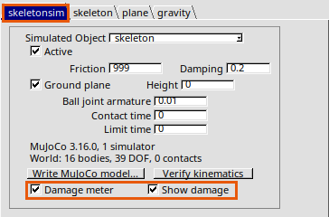

*Figure 11. The damage meter on the skeletonsim tab.*

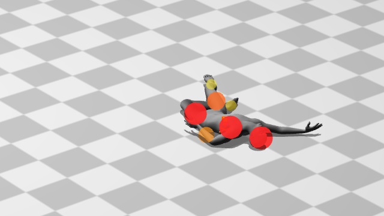

*Figure 12. After the launch from Section 4: red for the parts hit hardest.*

### The damage report

For numbers, open the console (**Window > Show-Hide Command Console**) and type:

```
dance.simulator("skeletonsim", "damage", "report")
```

It lists the total and each part, worst first. For each part it gives the hardest hit in newtons and the force that part takes safely. In this run the total was 60.8, and 57.4 of it was his head: hit at 14,659 N against a safe 400 N.

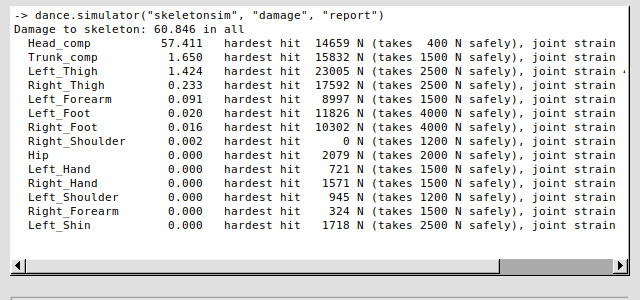

*Figure 13. The damage report for the launch.*

- `"total"` in place of `"report"` returns just the total.
- The damage goes back to 0 at the start of each run.
- After a Reset, the glow from the last run stays on screen until you press Play.

## 6. Attach him: hang from one hand

An attachment welds a body part to something. A **static** attachment pins the part in place where it is at the start of the run. Here you pin his raised left hand from Section 3, so he hangs from it.

1. Stop and Reset.
2. Clear the launch from Section 4: click **Velocities**, then **Reset all velocities**, answer **Yes**, and click **Set and Close**.
3. On the **skeleton** tab, click **Attachments**.
4. Set **Joint** to **Left\_Hand**.
5. Under **Static Attachments**, set **Geometries** to **plane**.
6. Tick **Show Attachments**. A line joins the hand to the plane.
7. Click **Set and Close**, then press **Play**. He drops and swings from his hand.

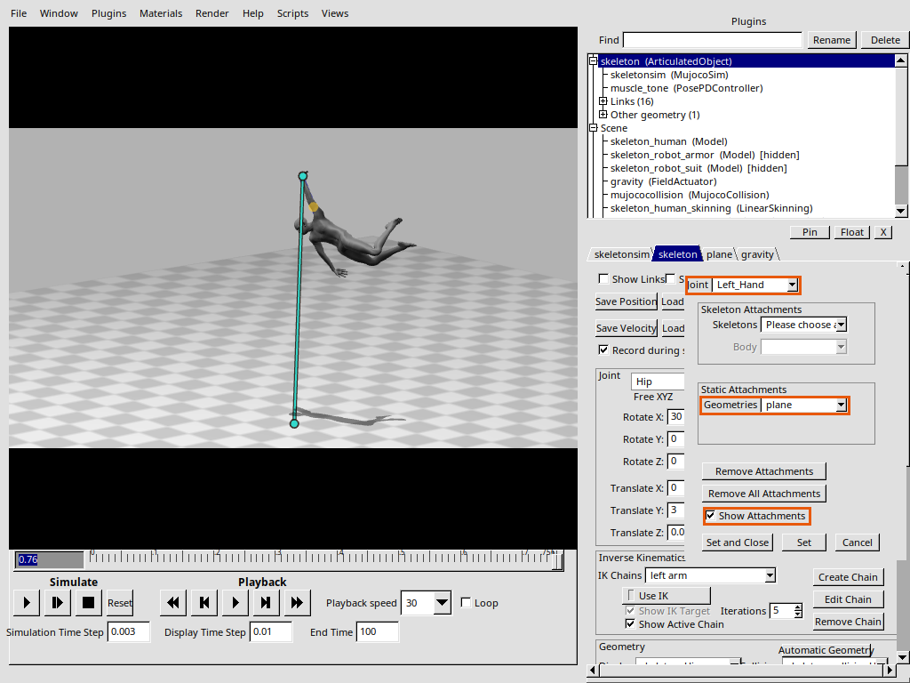

*Figure 14. Left\_Hand attached to the plane, 0.76 s into the run.*

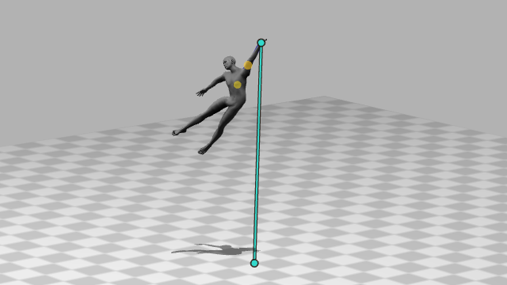

*Figure 15. Still hanging from the raised hand at 3.8 s.*

- The hand stays where it was at the start; the line to the plane only shows which object it is attached to.
- **Skeleton Attachments** joins a body part to a part of another skeleton (pick the skeleton, then its **Body** part). It needs a second skeleton in the scene.
- **Remove Attachments** removes the selected joint's attachments; **Remove All Attachments** removes every one.

## 7. Change his look

The character is a skeleton of 16 simulated body parts, drawn by default with a human skin that bends with him. The look changes only how he is drawn: the physics, and everything in this tutorial, stay the same.

- On the **skeleton** tab, scroll down to **Geometry** and choose **Look**: **human**, **robot**, **Bones** (each body part's own shape) or **Collision** (the shapes that collide).
- Or press **l** in the 3D view to go round the looks for every character in the scene.

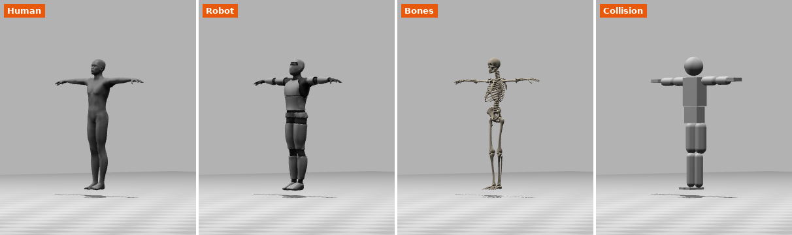

*Figure 16. The four looks: human, robot, bones and collision.*

Renders, exports and the AI control passes (Tutorial 4) show the look he has when you make them.

## Quick reference

| To | Where |
| --- | --- |
| Run, pause, stop | Play, Stop (under the view) |
| Start over | Stop, then Reset > Yes |
| Replay a run | Rewind, Play back, or drag the time slider |
| Orbit, pan, zoom | Alt + left-drag, Alt + middle-drag, right-drag |
| Move or turn the whole body | skeleton tab > Joint: Hip > Translate / Rotate |
| Pose a joint | skeleton tab > Joint: (any) > Rotate |
| Drag a hand or foot | skeleton tab > IK Chains > Use IK, then left-drag |
| Starting velocity | skeleton tab > Velocities > Initial |
| Preview the flight | Velocities > COM arc |
| Damage glow | skeletonsim tab > Damage meter |
| Damage numbers | Console: `dance.simulator("skeletonsim", "damage", "report")` |
| Pin a body part | skeleton tab > Attachments > Static Attachments |

Next, Tutorial 1a (Scripts > tutorials) builds the same hanging character from a script, and Tutorial 32 compares falls by their damage.
