# Stunt Double Tutorial 2: Objects and Collisions

Nov 9, 2026 · @Ari

## Before you start

In this tutorial you add a ball to Tutorial 1's scene, give it weight and speed, and use it three ways: shot at him, under him as he falls, and held in his hand. Along the way you add a wall for him to hit. It takes about 25 minutes.

It assumes you have done Tutorial 1. You will use the same panels: Joint and Translate to place things, Velocities and the COM arc to throw them, and Attachments to join them. **Stop, then Reset, before every change** still applies.

1. Load **Scripts > tutorials > Tutorial\_01\_Ragdoll**.
2. Choose **Scripts > basics > Create\_ball**. A 5 kg red ball, 0.15 m in radius, appears on the ground 1.5 m in front of him.

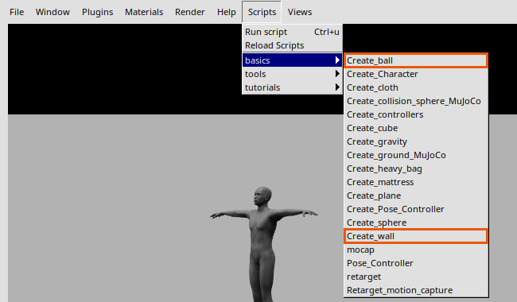

*Figure 1. The Scripts > basics menu. Create\_ball adds a ball; Create\_wall adds a wall.*

Both scripts work in any scene and can be run more than once. A second ball is named ball0 and starts 0.5 m further out; a second wall is named wall0 and sits 1 m further back.

## 1. Meet the ball: place it, set its mass

The ball is a one-part "skeleton": its only joint is **Ball**, a free joint like the Hip. So its tab is the same panel you used in Tutorial 1, and everything you learned there works on it.

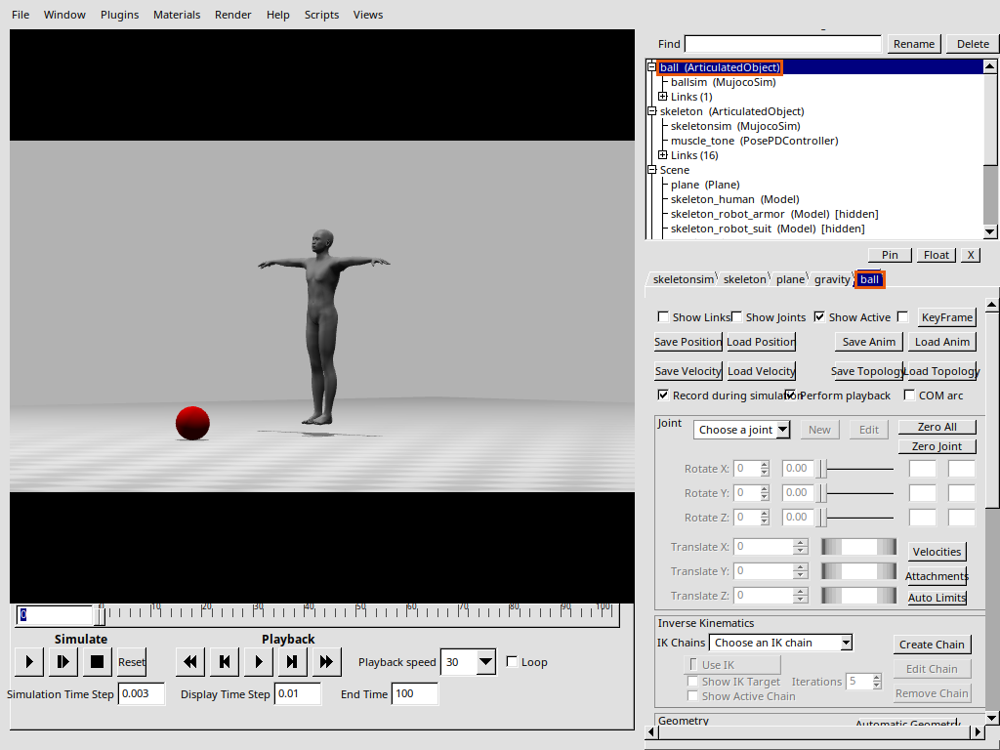

*Figure 2. The ball in the Plugins tree, with its own tab.*

### Place it

1. Open the **ball** tab and choose **Ball** under Joint.
2. Translate X, Y and Z are the centre of the ball, in metres. It starts at 0, 0.15 and 1.5: on the ground, in front of him.
3. Type new values to move it, for example Translate Y `2` to hold it 2 m up. Press Play and it drops to the ground.

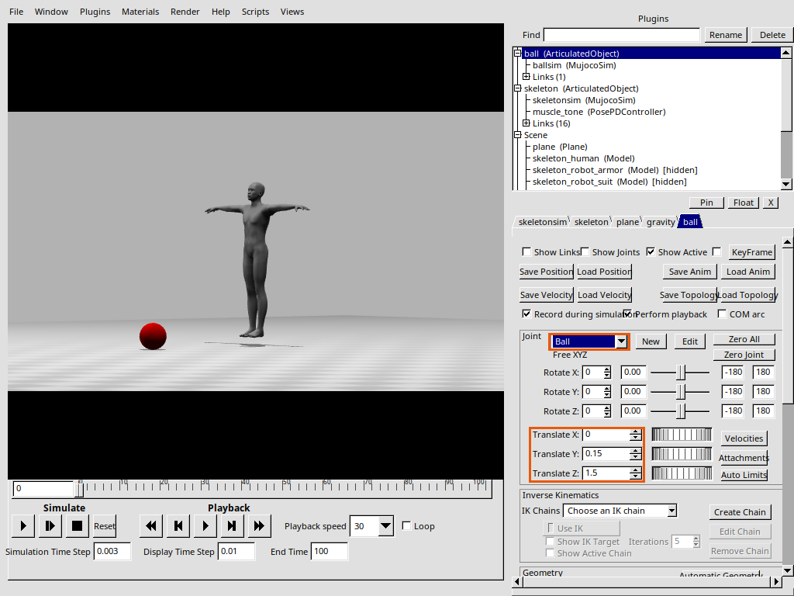

*Figure 3. The Ball joint: Translate is where the ball's centre is.*

### Set its mass

1. Scroll the ball tab down to **Physical Properties**.
2. Type `20` in **Mass** (kilograms) and press Enter.
3. Set the three **Moments** to `0.18`. Moments are how hard the ball is to spin. For a solid ball they are 0.4 × mass × radius², so 0.4 × 20 × 0.15² = 0.18.

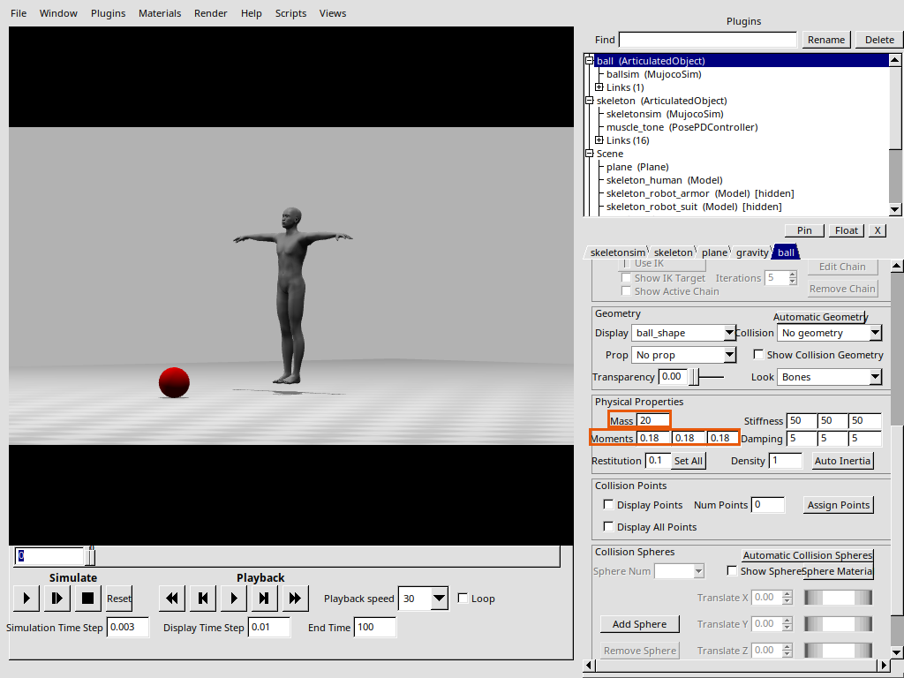

*Figure 4. A 20 kg ball, its moments set to match.*

**Auto Inertia** works the other way round: it sets both Mass and Moments from the ball's size and **Density**, in kg per cubic metre. Density 1000 (water) gives a 14 kg ball. Use it when you know what the ball is made of; type Mass and Moments when you know what it weighs.

## 2. Shoot the ball at him

You drop him from 3 m and fire the 20 kg ball level at his chest at 10 m/s. The hit happens in mid-air, so it doesn't matter that a limp ragdoll can't stand.

Why mid-air? Standing, he collapses on his own within a second, whether or not anything hits him, so a ball that hits him standing mostly changes how he crumples. In the air, the ball's push is the only thing moving him sideways. Gravity pulls the ball and him down at the same rate, so a ball fired level at his chest stays level with his chest until it hits.

### Set up the shot

1. Stop and Reset.
2. On the **skeleton** tab, choose **Hip** and set **Translate Y** to `3.0`. He hangs 1.9 m off the ground.
3. On the **ball** tab, choose **Ball** and set **Translate Y** to `3.35`, level with his chest. Leave X at 0 and Z at 1.5.
4. Click **Velocities**. Set **Linear Vel Z** to `-10`: 10 m/s straight at him. (He faces +Z, so -Z is toward him.)
5. Tick **COM arc**. The ball's arc runs through his chest and on behind him. Click **Set and Close**.

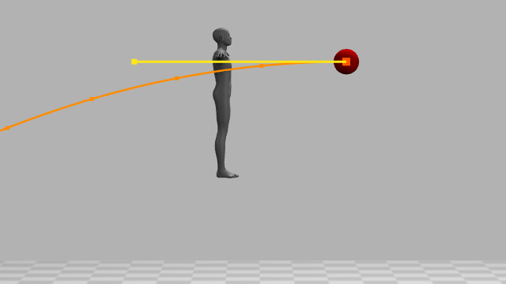

*Figure 5. Seen side-on: the ball's COM arc runs through his chest.*

### Fire

Press **Play**. The ball hits him about 0.15 s in, folds him around it and carries him backward as he falls.

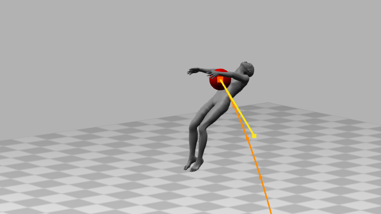

*Figure 6. The 20 kg ball folds him in half in mid-air.*

Try other masses in Physical Properties with the same speed. A 0.5 kg ball bounces off and he falls almost straight down. At 20 kg he is carried back about half a metre before he lands.

## 3. Add a wall: knock him into it

A wall is a box fixed in place: he and the ball hit it, but it never moves.

1. Stop and Reset. Keep the shot from Section 2.
2. Choose **Scripts > basics > Create\_wall**. A wall 4 m wide, 4 m tall and 0.3 m thick appears 1.5 m behind him, and its tab opens.
3. Press **Play**. The ball carries him back into the wall, and he slides down it.

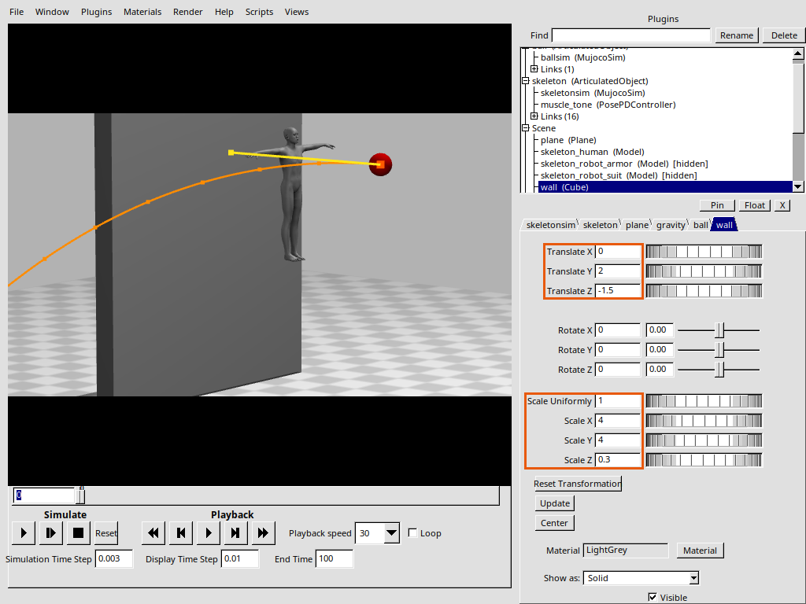

*Figure 7. The wall and its tab: Translate places its centre, Scale sets its size.*

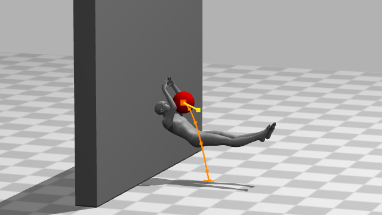

*Figure 8. Pinned against the wall by the ball.*

### Move or resize the wall

On the **wall** tab:

- **Translate X, Y, Z** is the wall's centre. Set Translate Z to `-1` to stand it closer behind him, or `-4` to move it out of the way.
- **Scale X, Y, Z** is its width, height and thickness in metres.
- **Rotate** turns it, in degrees.

Changes count from the next run, so Reset after moving it. A second Create\_wall adds another wall 1 m further back, for a corridor or a corner.

## 4. He falls on the ball

Now the ball stays still and he lands on it. Lay him flat on his back, 1.5 m up, with the ball on the ground under his upper back.

1. Stop and Reset. On the **wall** tab, set **Translate Z** to `-4` to move the wall out of the way.
2. On the **ball** tab, click **Velocities**, set Linear Vel Z back to `0`, and click **Set and Close**.
3. Still on the ball tab, set **Translate** X `0`, Y `0.15`, Z `-0.3`. The ball sits on the ground where his upper back will land.
4. On the **skeleton** tab, choose **Hip**. Set **Rotate X** to `-90` and **Translate Y** to `1.5`. He lies flat on his back, 1.5 m up, head toward the wall.
5. Press **Play**.

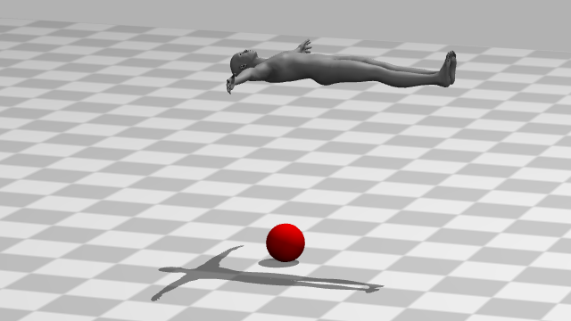

*Figure 9. Lying flat 1.5 m up, the ball under his upper back.*

His back lands across the ball. It props his upper body up, and he stays draped back over it.

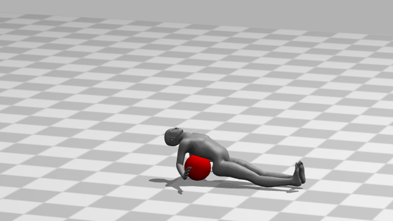

*Figure 10. Landing across the ball.*

Try the ball under his hips (Translate Z `0.1`) or his knees (`0.6`), and change the ball's mass.

## 5. He holds the ball: yanked off his feet

A skeleton attachment welds a body part to a part of another object. Here you weld his left hand to the ball, then throw the ball up and away, and it yanks him with it.

### Put the ball in his hand

1. Stop and Reset.
2. On the **skeleton** tab, choose **Hip** and stand him back up: **Rotate X** `0`, **Translate Y** `1.131`.
3. On the **ball** tab, set **Translate** X `0.95`, Y `1.59`, Z `0`. That puts the ball just beyond his left hand, which is at about X 0.78, Y 1.59.
4. In Physical Properties, set **Mass** to `60` and the three **Moments** to `0.54` (0.4 × 60 × 0.15²). A heavy ball is what makes the yank.

### Attach it

1. On the **skeleton** tab, click **Attachments**.
2. Set **Joint** to **Left\_Hand**.
3. Under **Skeleton Attachments**, set **Skeletons** to **ball**, then **Body** to **Ball**.
4. Tick **Show Attachments**: a short line joins the hand to the ball. Click **Set and Close**.

The weld holds the hand and the ball the way they are at the start, so place the ball where his hand should hold it before you press Play.

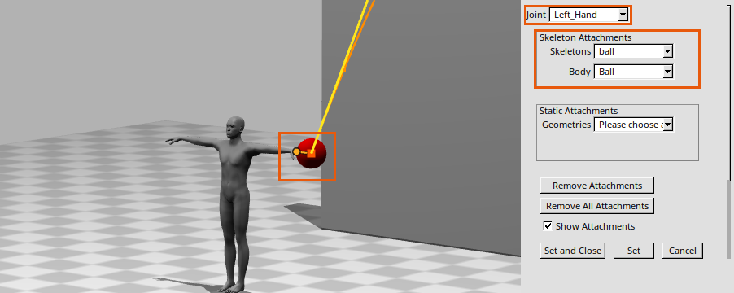

*Figure 11. The ball at his left hand, attached as a Skeleton Attachment, its COM arc pointing up and out.*

### Throw it

1. On the **ball** tab, click **Velocities**. Set **Linear Vel X** to `4` and **Linear Vel Y** to `9`: up and out to his left.
2. Tick **COM arc** to see where the ball wants to go, then **Set and Close**.
3. Press **Play**. The ball lifts him off his feet by the arm and swings him over, and he comes down head-first beside it.

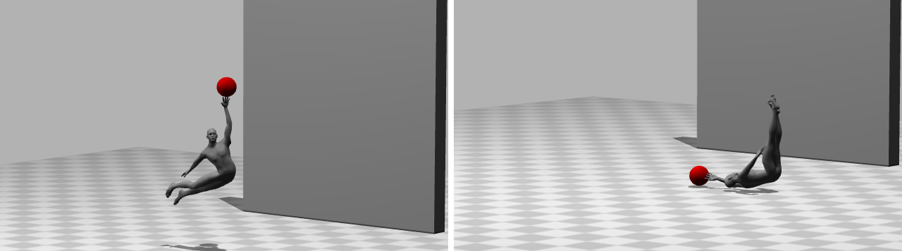

*Figure 12. Yanked off his feet (left) and flipped over (right).*

The attachment stays until you remove it: on the skeleton's Attachments window, choose Left\_Hand and click **Remove Attachments**. A 20 kg ball at 6 m/s only drags him to his knees; the ball's mass against his decides how big the yank is.

## Quick reference

| To | Where |
| --- | --- |
| Add a ball | Scripts > basics > Create\_ball |
| Add a wall | Scripts > basics > Create\_wall |
| Move the ball | ball tab > Joint: Ball > Translate |
| Ball's weight | ball tab > Physical Properties > Mass, Moments (0.4 × mass × radius²) |
| Weight from material | Physical Properties > Density, then Auto Inertia |
| Throw the ball | ball tab > Velocities > Initial, with COM arc |
| Move or size the wall | wall tab > Translate, Rotate, Scale |
| Ball in his hand | skeleton tab > Attachments > Skeleton Attachments: ball, Body: Ball |

Both scripts take settings when run from your own script, set before loading it: `ballMass`, `ballRadius`, `ballPosition`, `ballMaterial`, and `wallSize`, `wallPosition`, `wallMaterial`. For example, `ballMass = 50` and then `dance.load(dance.dancedir() + "/scripts/basics/Create_ball.py")`.

**Furniture and balls.** **Scripts > props** has 24 pieces of furniture and four balls (soccerBall, volleyball, baseball, football: their real sizes and weights, hollow, and bouncing as high as the real ones): pick one and it stands in a row 1.5 m in front of him, beside the others you've added (in an empty scene it brings the ground and gravity with it). From a script, Create\_prop adds any of the 24 (data/models/props/props.txt lists them: chairs, tables, a desk, a sofa, a bed, a bookcase, a fridge, a washing machine, boxes...), each a model that collides as a few boxes fitted to it, weighing what the real thing would:

```python
propName = "table"
propPosition = (0.0, 0.0, 1.35)    # where its base stands: y 0 is the floor
propYaw = 30.0                     # degrees about the vertical
dance.load(dance.dancedir() + "/scripts/basics/Create_prop.py")
```

`propMass` (kg) or `propDensity` (kg/m³) change its weight, `propFriction` how it slides (0.6 unless set). Its inertia and center of mass are worked out from its boxes. Change its mass later, in its panel or with `dance.system("table", "link", "Prop", "mass", 40)`, and its inertia goes with it. A ball's bounce is its MuJoCo simulator's: `dance.simulator("soccerBallsim", "bounce", 0.8)` (0 dead, 1 as high as it fell from). Balls don't slow as they roll (MuJoCo's contacts here have no rolling resistance): one knocked away keeps rolling. Don't place two props, or a prop and the character, overlapping: they start inside each other and fly apart. Your own model can be a prop too: `scripts/tools/props/build_props.py` fits boxes to any OBJ.
