# Stunt Double Tutorial 3: Controllers and the Timeline

Nov 9, 2026 · @Ari

## Before you start

In this tutorial you drive the character with controllers instead of letting him fall limp. He balances, holds a pose, jumps, and walks a motion-capture walk until he hits a wall. Then you script a short stunt on the timeline: he holds a ball, lets go of it, jumps, and goes limp at the top of the jump. Last, the windmill keeps him upright in the air by circling his arms and running his legs. It takes about 35 minutes and assumes you have done Tutorials 1 and 2.

1. Load **Scripts > tutorials > Tutorial\_01\_Ragdoll**.
2. Choose **Scripts > basics > Create\_controllers**.

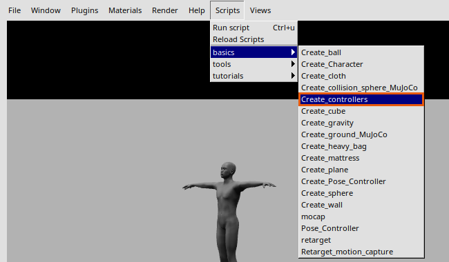

*Figure 1. Scripts > basics > Create\_controllers.*

Create\_controllers does four things:

- stands him up with his arms at his sides;
- puts the **balance controller** in charge of him;
- sets up the **pose**, **jump, fall and hybrid** controllers, ready to take over;
- sets the **Simulation Time Step** to 0.0005 s. The controllers are tuned for a step that short, so leave it there.

## 1. Who's in charge

A controller moves the character by pushing on his joints, the way muscles do. One controller drives him at a time. With none, he is a ragdoll, as in Tutorials 1 and 2.

You can see who is in charge in the Plugins tree: the controller in charge is listed under **skeleton**, and the others wait under **Scene**.

Each controller's tab starts with **Articulated Object**:

- choose **skeleton** to put that controller in charge;
- choose **Choose a system** (on the pose controller, **Choose an articulated object**) to take it off him.

To switch controllers, take the old one off first, then put the new one on. As always: Stop and Reset before you switch.

## 2. Balance: he stands

The balance controller keeps him on his feet. It watches his centre of mass over his feet and corrects with his ankles, and with his hips when the ankles aren't enough.

1. Press **Play**. He stands for as long as you let it run.
2. Stop and Reset.

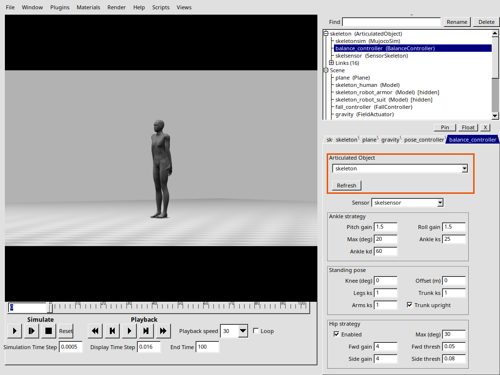

*Figure 2. The balance controller in charge: skeleton is chosen under Articulated Object.*

Its tab has the tuning: **Ankle strategy** (how hard the ankles correct), **Standing pose** (knee bend, stiffness of legs, trunk and arms) and **Hip strategy** (when and how much the hips help). The defaults stand him up; change one at a time and Reset to see what it does.

## 3. Pose: he holds a shape

The pose controller pulls each joint toward a stored pose, like a spring. It doesn't balance, so he holds the pose while he topples.

1. Stop and Reset.
2. On the **balance\_controller** tab, set Articulated Object to **Choose a system**. It moves under Scene.
3. In the Plugins tree, click **pose\_controller**. On its tab, set **Articulated Object** to **skeleton**. Its list of poses appears.
4. Click **block\_face** in **Poses**.
5. Press **Play**. He brings his forearms up in front of his face, holds it, and topples within a few seconds.

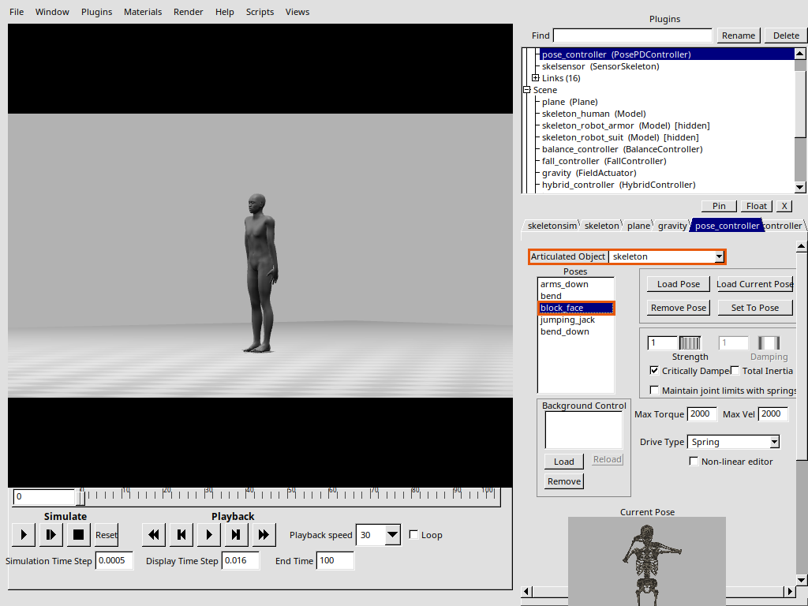

*Figure 3. The pose controller in charge, with block\_face chosen.*

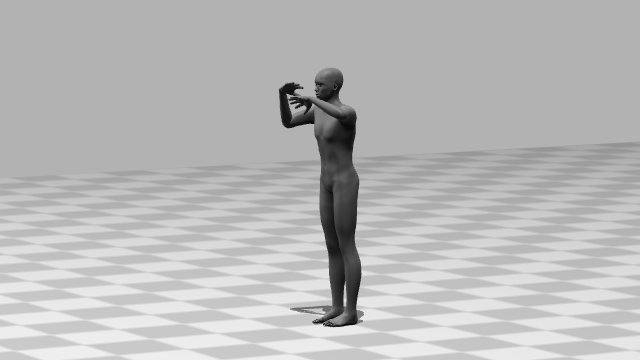

*Figure 4. Holding block\_face. Nothing balances him, so he goes over a moment later.*

- **Strength** is how hard the springs pull, **Damping** how much they resist moving fast (set for you while Critically Damped is ticked). Lower Strength makes him floppier.
- The poses are arms\_down, bend, block\_face, jumping\_jack and bend\_down. **Load Current Pose** adds his pose as it is now, so you can pose him (Tutorial 1's joints or IK) and then hold that pose.

## 4. Jump: he jumps straight up

The jump controller balances him like the balance controller, and jumps when you tell it to: it crouches, pushes off, lands and straightens up.

1. Stop and Reset.
2. On the **pose\_controller** tab, set Articulated Object to **Choose an articulated object**.
3. Click **jump\_controller** in the Plugins tree and set its Articulated Object to **skeleton**.
4. Press **Play**, then click **Jump**. About a second later he leaves the ground; his feet clear it by about 0.4 m and he lands standing.

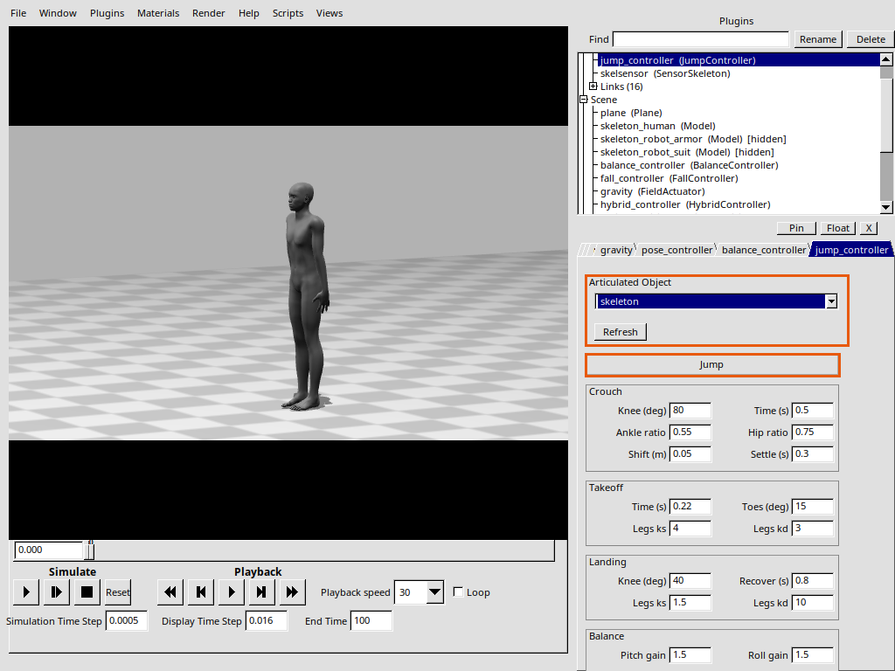

*Figure 5. The jump controller in charge, with its Jump button.*

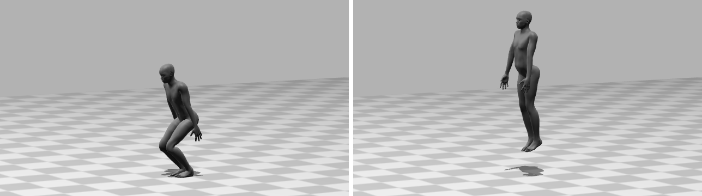

*Figure 6. The crouch (left) and the top of the jump (right).*

The console reports each landing, for example "landed at 3.426 s". The tab's groups tune each phase: **Crouch** (how deep and how fast), **Takeoff** (a shorter Time jumps higher), **Landing** (how much the knees give) and **Balance**. The landing is sensitive: change one number a little at a time.

The fall controller works the same way: put it in charge and he braces for a fall, with arms out, chin tucked and knees bent. The end of Section 6 swaps it in.

## 5. Hybrid: a motion-capture walk until he's hit

The hybrid controller plays recorded motion, such as motion capture, on the skeleton exactly as recorded (kinematics). When something hits him, it hands him to the simulation (dynamics), moving as he was, and he reacts physically. Create\_controllers sets it up with a recorded walk from Tutorial 26.

### Walk

1. Stop and Reset. Take the jump controller off him (Choose a system), so no controller is on.
2. Click **hybrid\_controller** in the Plugins tree and set its **Articulated Object** to **skeleton**. Under **Motion** it shows **480 frames, 7.98 s**.
3. Press **Play**. He walks forward, along +Z.

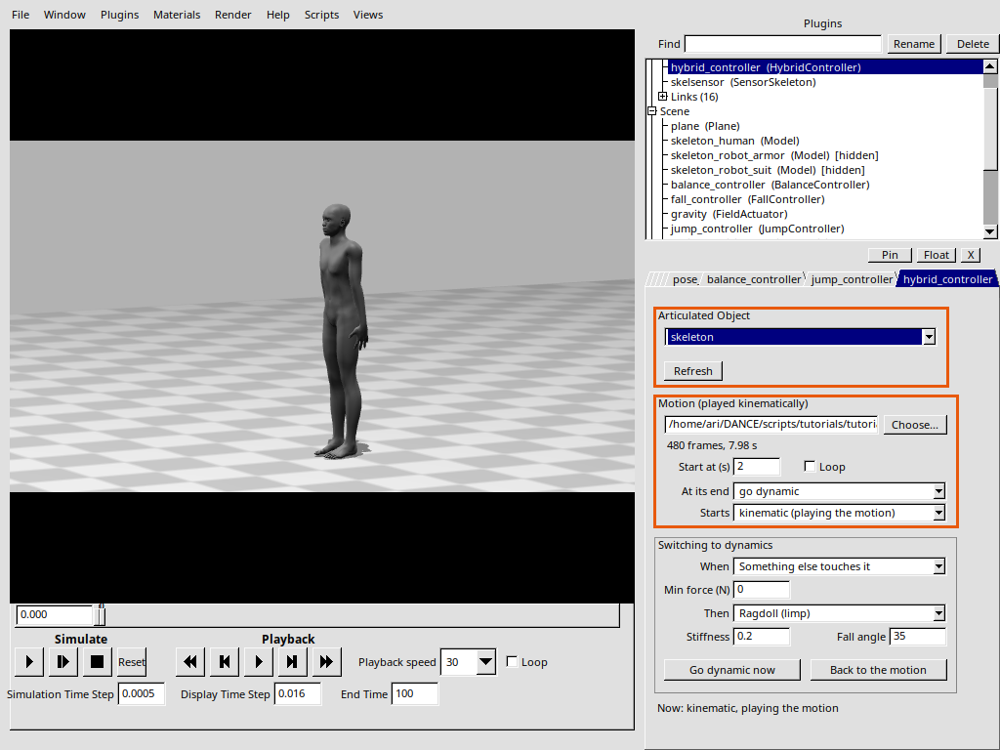

*Figure 7. The hybrid controller on the skeleton, with its walk loaded.*

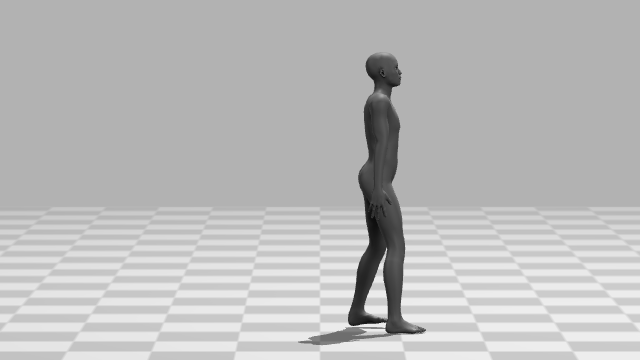

*Figure 8. Walking: the recorded motion, played exactly.*

On its tab:

- **Motion** is the file it plays. **Choose...** loads another: a motion the skeleton saved (Save Anim on the skeleton tab), or a BVH motion-capture file of any skeleton, which it retargets onto this one.
- **Start at (s)** is how far into the motion to begin. It's 2, where the walk is steady.
- **At its end**: go dynamic, or hold the last pose.
- **When** is what switches him to dynamics: something else touches him, he touches the ground with anything but his feet, either, or only when you click **Go dynamic now**.
- **Then** is what drives him after the switch.

### Walk into a wall

1. Stop and Reset.
2. Choose **Scripts > basics > Create\_wall**. On the wall's tab, set **Translate Z** to `2`. The wall now stands across his path.
3. Press **Play**. At 1.6 s his right thigh hits the wall, he switches to dynamics, and with Then set to **Ragdoll (limp)** he buckles and falls back.

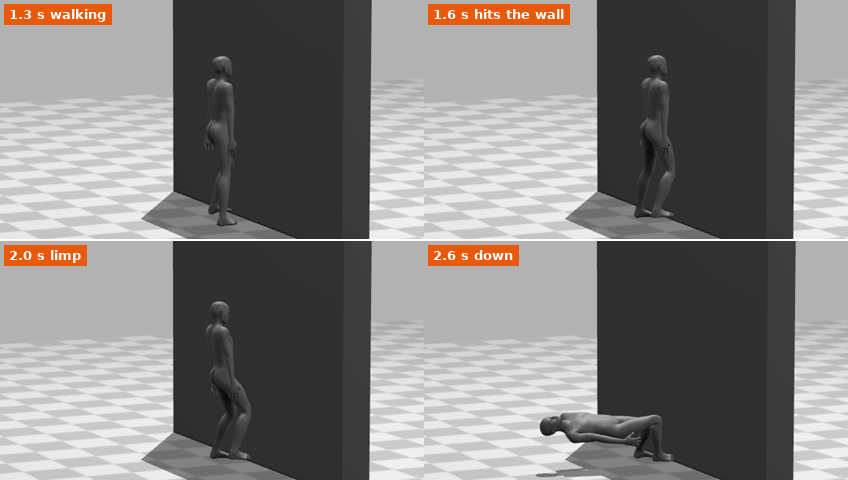

*Figure 9. Walking into the wall: the hit switches him from the recording to the simulation.*

The console names the hit, for example "dynamics at 1.599 s: Right\_Thigh hit by wall (87 N)". The status line at the bottom of the tab shows it too.

### Let another controller take over

The hybrid controller is the one exception to "one controller at a time": another controller can be on the skeleton too, and the hybrid controller holds it off until the switch.

1. Stop and Reset.
2. Put the **balance controller** back on the skeleton, leaving the hybrid controller on.
3. On the **hybrid\_controller** tab, set **Then** to **balance\_controller**.
4. Press **Play**. He walks into the wall, and this time the balance controller catches him and he stays standing against it.

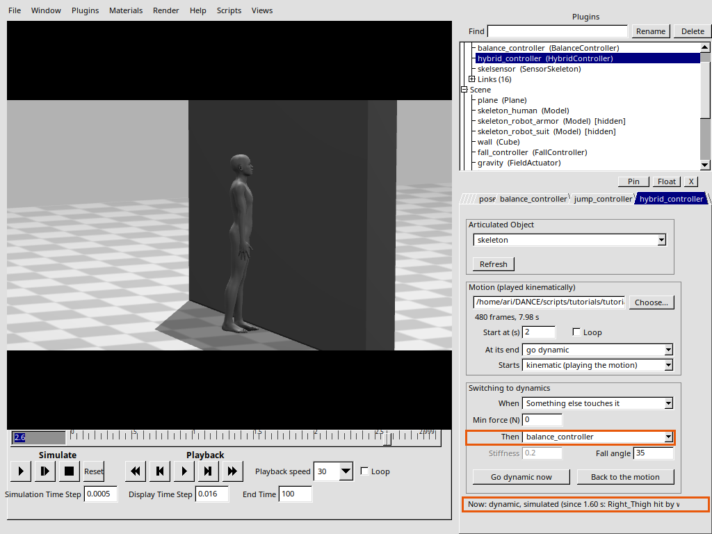

*Figure 10. Then: balance\_controller. After the hit he is simulated and balancing.*

**Stiffness** (for the ragdoll) is how strongly his joints still pull toward the pose he was hit in; low is nearly limp. **Fall angle** is how far his trunk may tilt before the controller that took over gives up and he goes limp.

## 6. The timeline: a stunt in five events

The timeline changes the scene at set times while it simulates: it attaches and releases body parts, switches controllers, sends commands to a controller, pushes and runs Python. You'll build this stunt:

| Time | Event | What happens |
| --- | --- | --- |
| 0 s | Attach Right\_Hand to the ball | He holds a ball |
| 1 s | Detach Right\_Hand | He lets go, and the ball drops |
| 1.5 s | Switch controller: balance to jump | The jump controller takes over |
| 1.55 s | Controller setting: jump\_controller, `jump` | He jumps |
| 2.8 s | Ragdoll | He goes limp at the top of the jump |

### Set up

1. Stop and Reset. Take the jump controller off him and put the **balance controller** back in charge.
2. Choose **Scripts > basics > Create\_ball**. On the ball's tab, choose the joint **Ball** and set **Translate** X `-0.24`, Y `0.8`, Z `0.17`: just in front of his right hand. In Physical Properties set **Mass** `1` and the three **Moments** `0.009`.
3. Choose **Window > Timeline**. A timeline window opens with a row for each object (Scene, skeleton, ball) and time across the top; the timeline's own tab opens beside it.

### Add the events

Click an empty spot on a row to add an event there. A menu lists the kinds; the event's details then show on the timeline's tab, where you set them.

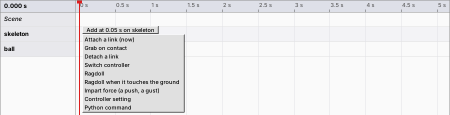

*Figure 11. Clicking the skeleton row: the kinds of event.*

1. **Hold the ball.** Click the skeleton row near 0 s and choose **Attach a link (now)**. On the tab set **Time** `0`, **Link** **Right\_Hand**, **Attach to** **ball**. **Its link** becomes **Ball**.
2. **Let go.** Click the skeleton row near 1 s, choose **Detach a link**, set **Time** `1` and **Link** **Right\_Hand**.
3. **Hand over to the jump controller.** Click near 1.5 s, choose **Switch controller**, set **Time** `1.5`, **Stop** **balance\_controller**, **Start** **jump\_controller**.
4. **Jump.** Click a free spot, choose **Controller setting**, set **Time** `1.55`, **Controller** **jump\_controller**, **Command** `jump`. A setting is any command the controller takes; this one is the Jump button.
5. **Go limp.** Click near 2.8 s and choose **Ragdoll**. Set **Time** `2.8`. Stop reads **(whatever is acting)** and Start **(none: ragdoll)**.

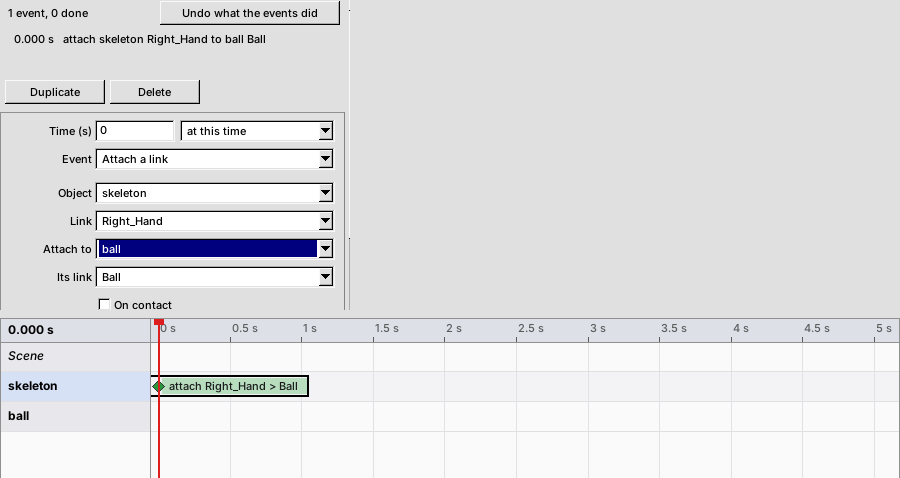

*Figure 12. The first event: Right\_Hand attached to the ball at 0 s.*

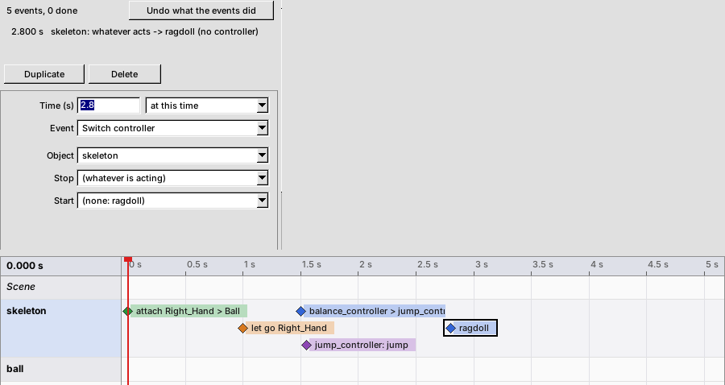

*Figure 13. All five events, with the ragdoll event selected.*

### Play it

Press **Play**. He holds the ball, drops it at 1 s, crouches, jumps, and goes limp at the top of the jump. The tab counts the events as they happen ("5 events, 5 done").

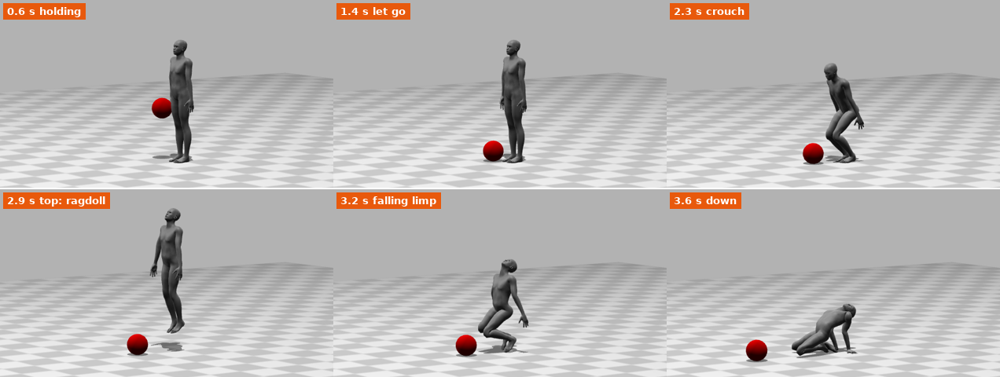

*Figure 14. The stunt, frame by frame.*

- Drag an event's block along its row to change its time, or click it and type a new Time.
- Reset puts back what the events changed: the ball back in his hand, the balance controller back in charge.
- **Undo what the events did** does the same without resetting the simulation.
- Change the last event's **Start** to **fall\_controller** and he braces for the landing instead of going limp.

## 7. Windmill: righting himself in the air

Once he leaves the ground nothing can push on him, so his spin can't change by itself. What he can do is turn part of himself one way, which turns the rest of him the other way. Long jumpers do this with arm circles and a running action in the air, called a hitch kick. The windmill controller does the same: it watches how far his trunk tips, and circles his arms and runs his legs whichever way brings him back to the pitch it is set to hold.

1. Load **Scripts > tutorials > Tutorial\_45\_Windmill\_In\_The\_Air**. It is a scene of its own: he starts 3 m up, thrown forward at 4 m/s and up at 5 m/s, tipping forward at 1 rad/s.
2. Press **Play**. His arms circle forward over his head, close to three times a second, and his legs run. He touches down leaning 22° forward instead of landing on his face.
3. Stop and Reset. On the **windmill** tab, set Articulated Object to **Choose a system**, and press **Play** again. The same throw with his arms and legs still lands him face down.

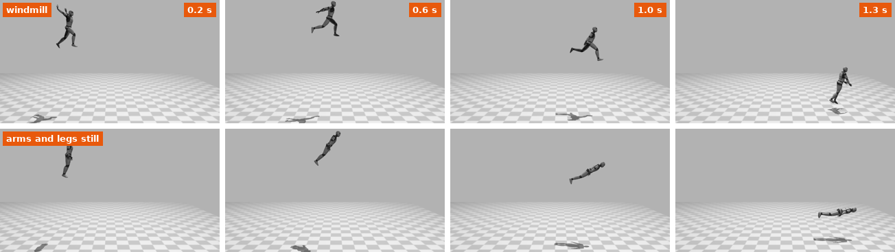

*Figure 15. The same throw with the windmill (top) and with his arms and legs still (bottom).*

### Its settings

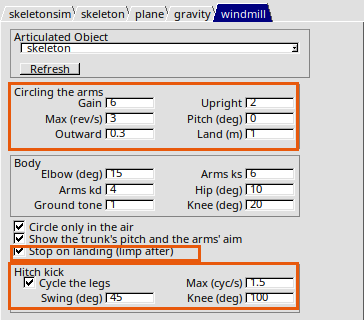

*Figure 16. The windmill tab.*

- **Circling the arms**:
  - **Gain** is how fast the arms circle for a given rate of tip.
  - **Upright** is how quickly it brings him back.
  - **Max (rev/s)** is the fastest the arms go. 3 is about as fast as a person can; 8 holds him almost perfectly upright, but no person could do it.
  - **Pitch (deg)** is the lean it holds: 0 is upright, -90 is flat on his back.
  - **Land (m)** times the turn so he reaches that pitch just as his center of mass comes down to that height. Below 0, it heads for the pitch straight away.
- **Hitch kick**: **Cycle the legs** turns the running on, and **Max (cyc/s)** keeps it to about a sprinter's 1.5 strides a second. The legs only help turn him back: kicked the other way, the leg can't reach far enough behind the hip. For a backward tip, the arms work alone.
- **Stop on landing**: at the first touch he goes limp, a ragdoll. With it off, the controller keeps holding his pose on the ground, loosened by **Ground tone**.
- **Show the trunk's pitch and the arms' aim**: green is straight up, yellow is his trunk, and cyan is where each arm is aiming.

Two other tutorials use the windmill to steer a fall rather than stop one. In Tutorial 42 he falls backward off a 5 m platform onto a crash mat, and a Pitch of about -90 brings him in flat on his back however hard he pushed off. Tutorial 28 uses it to land him face down on the table.

## Quick reference

| To | Where |
| --- | --- |
| Add the controllers | Scripts > basics > Create\_controllers |
| Put a controller in charge | its tab > Articulated Object: skeleton |
| Take it off | its tab > Articulated Object: Choose a system |
| Hold a pose | pose\_controller tab > Poses |
| Jump now | jump\_controller tab > Jump |
| Open the timeline | Window > Timeline |
| Add an event | click an empty spot on a row |
| Change an event | click its block; edit it on the timeline tab |
| Move an event | drag its block along the row |
| Keep him upright in the air | windmill tab > Articulated Object: skeleton (Tutorial 45) |
| Land him at another angle | windmill tab > Pitch (deg), with Land (m) |

### More events

The event menu has more than this stunt used:

- **Grab on contact**: from its time on, the hand takes hold the moment it touches something, like catching a bar.
- **Ragdoll when it touches the ground**: goes limp on the first contact with the ground.
- **Impart force (a push, a gust)**: pushes a body part, or the whole body, for a while. Drag the block's ends to make it last longer. Use it to shove him while the balance controller holds him up.
- **Python command**: runs a line of Python at that time.

Tutorial 22 (Scripts > tutorials) is a timeline scene with more controllers set up: broad jump, walk and get-up. Tutorial 26 is the hybrid walk hit by a thrown ball, with the reach controller clutching where he was hit.
