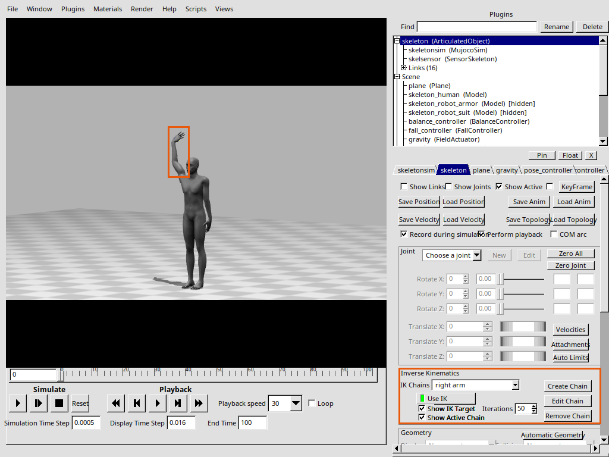
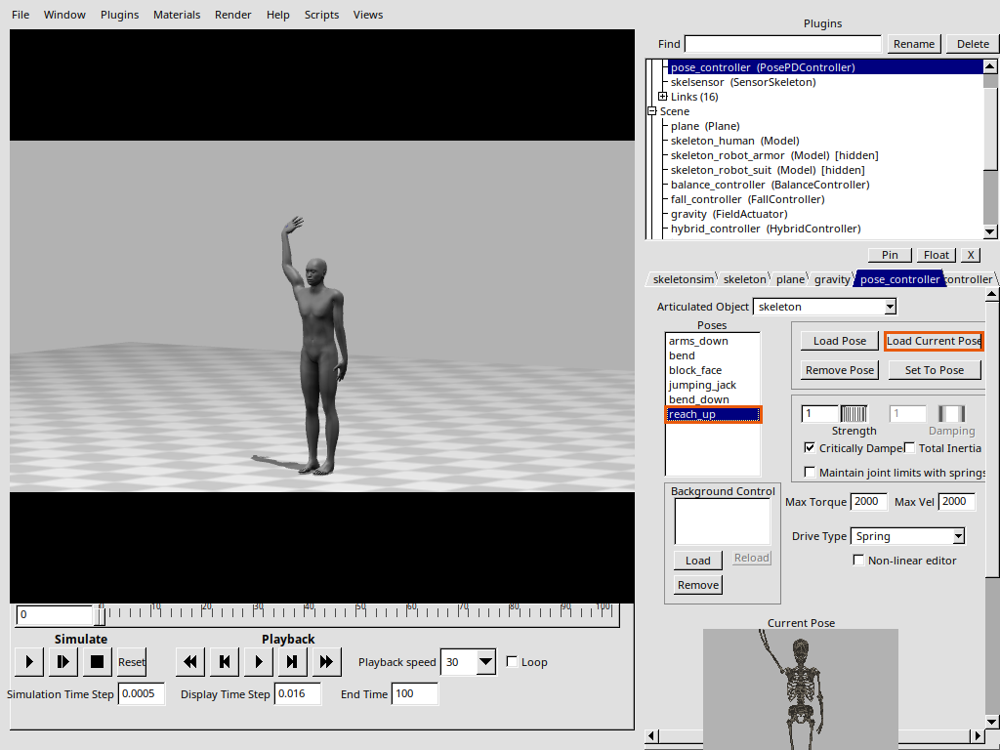
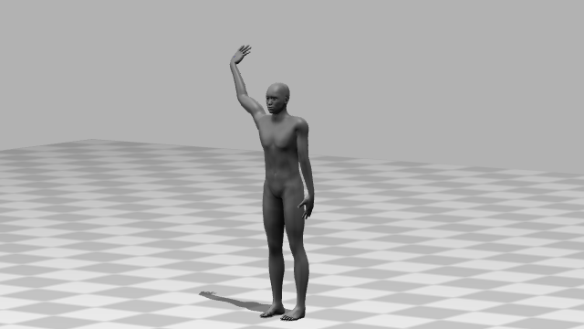
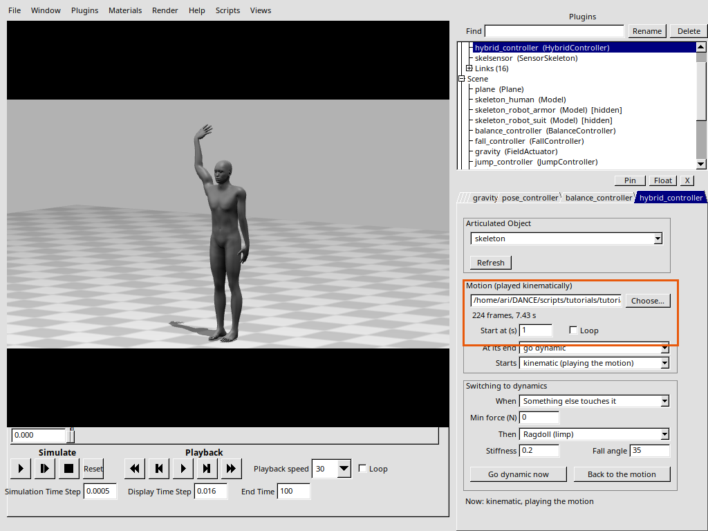
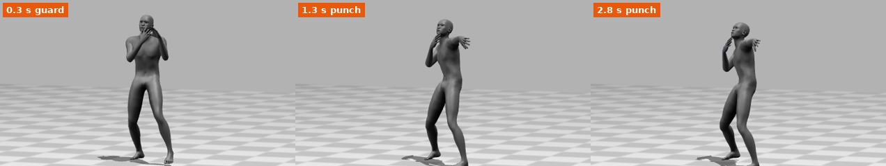
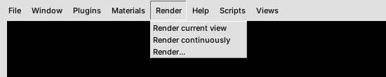
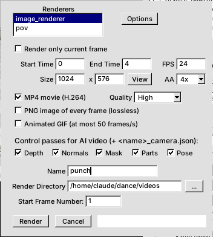
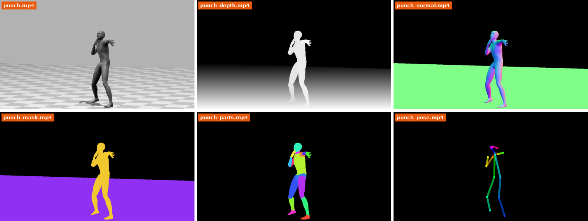

# Stunt Double Tutorial 4: IK, Motion Capture and Rendering

Nov 10, 2026 · @Ari

## Before you start

In this tutorial you pose him with inverse kinematics (IK) and keep that pose with the pose controller. Then you put motion capture on him from a BVH file, and render the result as a video along with the control passes that AI image and video models follow. It takes about 30 minutes and assumes you have done Tutorials 1 and 3.

1. Load **Scripts > tutorials > Tutorial\_01\_Ragdoll**.
2. Choose **Scripts > basics > Create\_controllers**.
3. On the **balance\_controller** tab, set Articulated Object to **Choose a system**. No controller is on him now.

## 1. Pose with IK, and keep the pose

Tutorial 1 used IK to place a hand before a fall. Here you raise his right hand and save the pose to the pose controller, so the simulation holds it.

### Drag the hand

1. Stop and Reset. On the **skeleton** tab, under **Inverse Kinematics**, choose **right arm** in **IK Chains**.
2. Click **Use IK**, and tick **Show IK Target** and **Show Active Chain**. The arm's chain is drawn in blue, faintly through the skin (Tutorial 1, Section 7: the Bones look shows it fully).
3. Set **Iterations** to `50`. With the default 5, the hand stops short of the mouse on a long drag.
4. Left-drag in the view to raise his hand above his head.
5. Click **Use IK** again to turn it off.

*Figure 1. The right arm raised with IK, at 50 iterations.*

The chains are left arm, right arm, left leg, right leg, "with body" versions that also bend the trunk, and the head. **Create Chain** makes a chain of your own.

### Keep the pose

A pose set with IK is only where he starts. Without a controller he falls limp from it. To keep it:

1. Click **pose\_controller** in the Plugins tree and set its Articulated Object to **skeleton**.
2. Click **Load Current Pose**, name it `reach_up`, and click **OK**. It joins the list of poses.
3. Click **reach\_up** in Poses and press **Play**. He holds the raised arm, and topples a few seconds later, since the pose controller doesn't balance.

*Figure 2. reach\_up added to the pose controller's poses.*

*Figure 3. Holding reach\_up in the simulation.*

The saved pose can be used anywhere a pose is chosen, including a timeline **Controller setting** event (Tutorial 3) on pose\_controller with the command desired\_pose reach\_up, to switch to it partway through a stunt.

## 2. Motion capture: put a BVH on him

Motion capture comes as BVH files, recorded on someone else's skeleton with its own joints and proportions. Stunt Double **retargets** it: it matches the hips, spine, neck, head, arms and legs by their names and the hierarchy, and converts the motion onto this skeleton's joints. The hybrid controller (Tutorial 3) then plays it.

1. Stop and Reset. Take the pose controller off him (Choose an articulated object).
2. Click **hybrid\_controller** and set its Articulated Object to **skeleton**.
3. Under Motion, click **Choose...**, go to `scripts/tutorials/tutorial27data`, choose **punch.bvh** and click **OK**.
4. The console reports that the joints don't match (22 in the file, 16 on the skeleton) and that it is retargeting. A moment later Motion shows **224 frames, 7.43 s**.
5. Set **Start at (s)** to `1`, where the punching starts, and press **Play**.

*Figure 4. punch.bvh retargeted onto the skeleton: 224 frames, 7.43 s.*

*Figure 5. The retargeted punches.*

- The retargeted motion is saved as `data/motions/retargeted/punch_skeleton.anim`, so loading the same BVH again is instant.
- The punch, kick and walk in tutorial27data, and the clips in `data/motions/bandai-namco`, are from the Bandai Namco Research Motion Dataset (CC BY-NC 4.0, non-commercial).
- Any BVH should work (CMU, Mixamo, Rokoko and so on). If retargeting can't find the body parts by their names, `scripts/basics/retarget.py` explains how to name them.
- Everything from Tutorial 3 still applies: with **When** set to "Something else touches it", a thrown ball or a wall switches him from the motion capture to the simulation. Tutorial 27 does that with a medicine ball.

## 3. Save a video

Rendering turns the recorded run into a movie from the view's camera. Simulate first: Render draws what was recorded, so run the punch from Section 2 for at least 4 s and press Stop.

1. Frame the shot in the 3D view. The movie uses this camera.
2. Choose **Render > Render...**.
3. Set **End Time** `4`, **FPS** `24`, and **Size** `1024` x `576`. **View** sets the size to the view's instead.
4. Leave **MP4 movie (H.264)** ticked. Set **Name** to `punch`.
5. Click **Render**. It draws each frame and writes `punch.mp4` to the **Render Directory**, by default the `videos` folder.

*Figure 6. The Render menu.*

*Figure 7. The Render window, set up for this tutorial, with all five control passes ticked.*

- **Quality** and **AA** (antialiasing) trade file size and render time for sharpness.
- **PNG image of every frame** writes lossless frames as well, for editing or compositing.
- **Animated GIF** writes a GIF, at up to 50 frames a second.
- The Render menu's other items, Render current view and Render continuously, aren't needed for this tutorial.

## 4. Control passes: depth, normals, mask, parts and pose

The ticks under **Control passes for AI video** render the same shot a second way, frame for frame and from the same camera. Each pass describes one thing about the shot, in the format AI image and video models are guided by. Tick all five and render again. You get six movies, all 97 frames at 1024 x 576, plus three data files.

*Figure 8. The same frame in the movie and its five passes.*

| File | What it shows |
| --- | --- |
| punch.mp4 | The movie, as the view draws it |
| punch\_depth.mp4 | Distance: near is white, far is black, on one scale for the whole movie so it doesn't flicker. With PNG frames ticked, also 16-bit depth images in millimetres |
| punch\_normal.mp4 | Which way each surface faces, in camera space: red is right, green is up, blue is toward the camera |
| punch\_mask.mp4 | Each object in its own flat colour; punch\_mask.json says which colour is which object |
| punch\_parts.mp4 | Each body part in its own flat colour |
| punch\_pose.mp4 | The skeleton drawn as OpenPose draws a person: 18 COCO keypoints joined by coloured limbs |
| punch\_pose.json | Those keypoints for every frame, in pixels and in metres in camera space |
| punch\_camera.json | The camera: its intrinsics, and where it is in every frame, in OpenCV and OpenGL conventions |

The passes are drawn from the recorded motion and the scenery, not from the view's pixels, so they match each other and the movie exactly. They show him in the look he has (the human skin by default) and as File > Export... exports him (Tutorial 40), so a scene rebuilt in Blender, Unity or Unreal lines up with them too.

## 5. From passes to AI imagery

An AI image or video model can turn the character into a photorealistic person, in any setting you describe, while the passes hold it to Stunt Double's motion: the pose pass keeps the body positions, depth and normals keep the shapes and the camera, and the masks say which pixels are the person. The physics comes from the simulation; the look comes from the model and your prompt.

| Pass | What a model uses it for |
| --- | --- |
| Pose | The person's body position in every frame (pose ControlNets, video models that follow a pose video) |
| Depth | The 3D layout and camera: what is near and far |
| Normals | Surface shape, for finer detail than depth |
| Mask, parts | Limiting the changes to him, or to the background; compositing him over a real plate |
| Camera | Matching a real or 3D camera to the shot |

### Where to use them

- **One image at a time:** in ComfyUI, Automatic1111 or Forge with ControlNet, use a pass as each frame's control image (tick **PNG image of every frame** to get them as images), with a prompt for the shot. This is the simplest start, but frames made separately flicker.
- **Video:** a video model that takes a control video, such as Wan's VACE, CogVideoX's ControlNets or AnimateDiff with ControlNet, given punch\_pose.mp4 or punch\_depth.mp4 and a prompt.
- **Video-to-video services**, which restyle a clip but keep its motion: give them the movie, or the depth or pose pass.

### Tips

- Render at a size and frame rate the model takes: 1024 x 576 at 16 to 30 frames a second suits most video models.
- Start with the pose pass alone. Add depth when the model loses the body's shape or the camera drifts.
- Write the prompt about the person and the place, for example "a stuntman in a leather jacket throwing punches in a rainy alley at night, cinematic lighting". The motion is already decided by the pass.
- Output quality depends heavily on the model. Small models that fit on one consumer graphics card follow the motion well but look less real than larger ones.

Tutorial 41 (Scripts > tutorials) renders Tutorial 34's stunt fall with all its passes from a script, into `dance_exports/ai_passes` in your home folder.

## Quick reference

| To | Where |
| --- | --- |
| Drag a hand or foot | skeleton tab > IK Chains > Use IK, then left-drag (raise Iterations if it lags) |
| Keep a pose | pose\_controller tab > Load Current Pose, then choose it in Poses |
| Play motion capture | hybrid\_controller tab > Motion > Choose... (a .bvh is retargeted) |
| Start partway in | hybrid\_controller tab > Start at (s) |
| Save a video | Render > Render..., MP4 movie, Render |
| Passes for AI | Render window > Control passes for AI video |
| Frames as images | Render window > PNG image of every frame |
| The passes from a script | Tutorial 41 |
