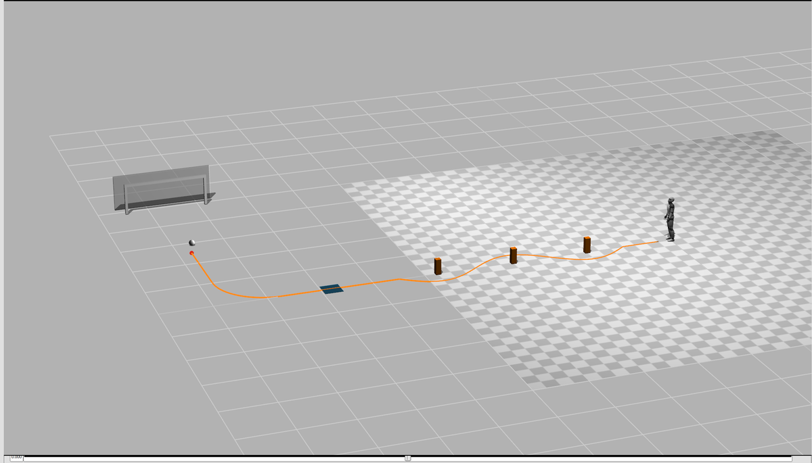
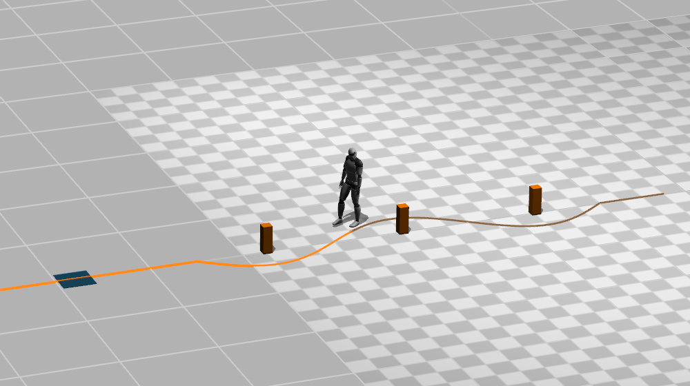
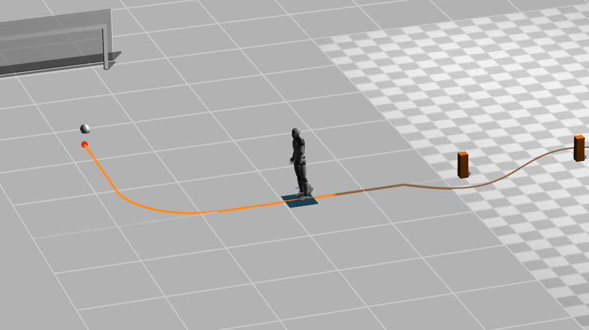
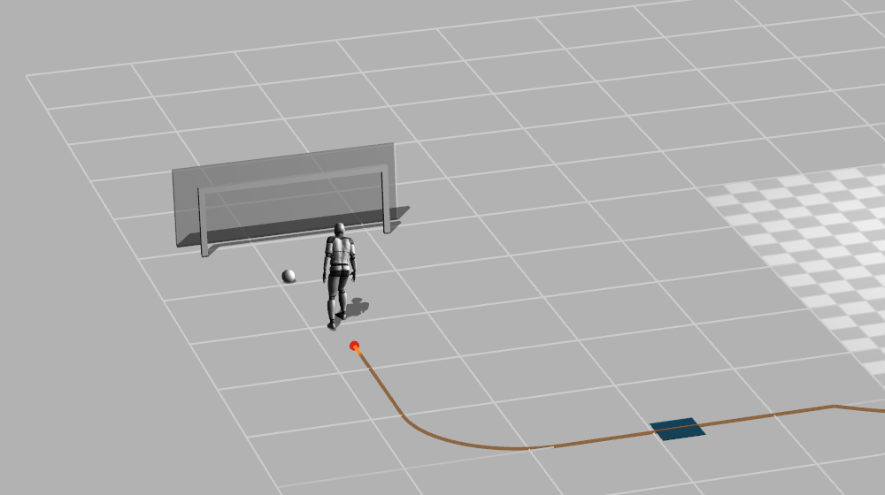
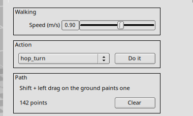
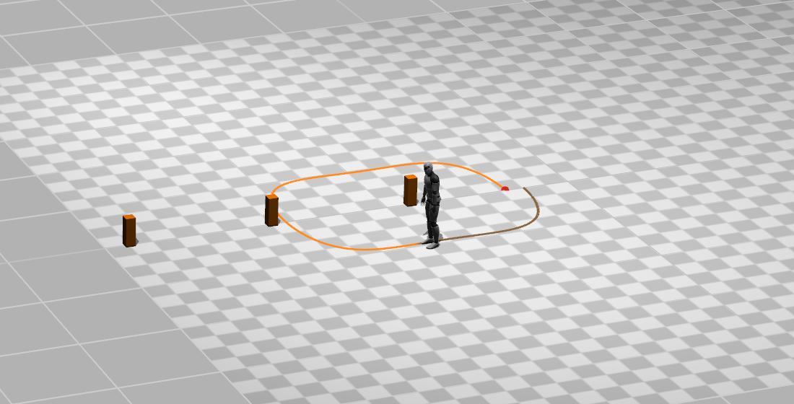
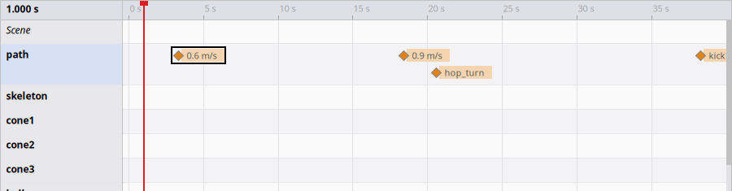
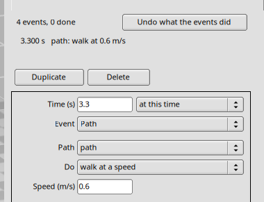
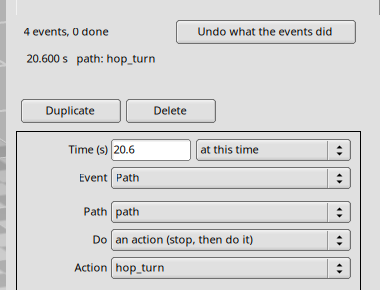

# Stunt Double Tutorial 5: Paths and Actions

Nov 17, 2026 · @Ari

## Before you start

In this tutorial a robot walks an obstacle course you can change. He weaves between cones, spins on a marked spot, and kicks a ball into a goal, all under physics. You steer him with a path drawn on the ground, and you script what he does along it on the timeline. Then you paint a path of your own and give him new things to do. It takes about 30 minutes and assumes you have done Tutorials 1 and 3 (the timeline).

1. Load **Scripts > tutorials > Tutorial\_47\_Obstacle\_Course**.
2. Wait a few seconds while it loads the character, his trained network and the motion-capture database. The view shows the whole course, and the **Timeline** window opens beside it.

## 1. The obstacle course

The course is 22 m long and takes him about 45 s. Press **Play** and watch it through once:

*Figure 1. The course at the start. The orange line is his path.*

1. He slows down and weaves between the three orange cones.
2. He speeds up again, stops on the blue spot, and spins round (a hop turn). Then he turns back and carries on.
3. He follows the bend to the left and walks up to the white ball.
4. He stops, stands still a moment, and kicks the ball into the goal. The see-through net behind it stops the ball.

*Figure 2. Weaving between the cones.*

*Figure 3. Stopped on the blue spot, about to spin.*

*Figure 4. The kick. The ball is on its way into the goal.*

What you see on the course:

- **The orange line** is his path. The part he has already walked turns darker, and a red dot marks its end.
- **The cones, the ball and the net** are simulated, like him. Stray into a cone and it falls over.
- **The blue spot and the goal** are only scenery. Nothing collides with them.

Stop and Reset to start over. Rewinding puts the cones and the ball back, and his speed with them.

## 2. How he walks

Nobody animates him by hand. Two learned parts work together, 30 times a second:

1. **Motion matching** picks what he should be doing from a library of motion capture: walks, turns, stops, jumps, kicks and punches. It looks ahead along the path and chooses the clip that fits best. The result is his *reference*, the motion he is trying to make.
2. **A trained network** performs that reference under physics. It pushes on his joints, like muscles, to follow it while keeping his balance. He can trip, stumble and be knocked about like the ragdolls in Tutorials 1 and 2.

The path tells motion matching where to go:

- he heads for a point about 1 m ahead of him along the path;
- he slows down for tight bends and as he nears the end;
- he stops at the end.

An action (a kick, a jump) makes him stop first. He stands still for a second, then does it, then carries on along the path. Starting an action mid-stride, with a foot still coming down, is where he tends to fall, so he waits.

## 3. The path's panel

The path has a panel of its own for steering him by hand while he runs.

1. In the Plugins tree, click **path (PathPainter)**.
2. Press **Play**.
3. While he walks, move the **Speed** slider. He speeds up or slows down gradually.
4. Choose an action in the **Action** menu and click **Do it**. He stops, stands still a moment, does it, and carries on along the path.

*Figure 5. The path's panel: walking speed, an action to do now, and the path itself.*

The panel has three parts:

- **Walking**: **Speed**, from 0.3 to 1.4 m/s. The walks he learned from go up to about 1 m/s, so faster than that is shakier.
- **Action**: the actions his motion capture has: **hop\_turn**, **jump**, **jump\_forward**, **kick** and **punch**.
- **Path**: how many points the path has, and **Clear**, which forgets it. With no path he stops where he is.

## 4. Paint your own path

You can draw him a new path with the mouse, while he runs or before.

1. Hold **Shift** and drag with the **left mouse button** across the ground. An orange line follows the mouse.
2. Let go. The new path replaces the course's, and the console says how many points it has.
3. Press **Play** if he isn't running. He walks to the nearest part of your path, follows it, and stops at its end.

*Figure 6. A path painted around a cone. The part he has walked turns darker.*

Tips:

- Paint at a comfortable pace: the points are 0.15 m apart, however fast you drag.
- Gentle curves work best. He slows into tight bends, but a hairpin can still trip him.
- **Alt** with the mouse still moves the camera, and **Ctrl** with the left button still grabs a body, as in Tutorial 1.
- The timeline's path events (next section) still apply to your path: they happen at their times, wherever he is.

## 5. Path events on the timeline

What he does along the course is scripted on the timeline, as path events, like the timed events in Tutorial 3. The **path** row, second from the top, holds four orange blocks:

| Time | Event | What happens |
| --- | --- | --- |
| 3.3 s | 0.6 m/s | He slows down for the cones |
| 18.4 s | 0.9 m/s | He speeds up after them |
| 20.6 s | hop\_turn | He stops on the blue spot and spins |
| 38.3 s | kick | He has reached the end: he kicks the ball |

*Figure 7. The Timeline window: the path row with its speeds and actions.*

To change one:

1. Click a block. The timeline's panel opens on the right, showing that event.
2. For a speed, type a new **Speed (m/s)** and press Enter. For an action, choose another in the **Action** menu.
3. To do it at another time, drag the block along its row, or type a new **Time (s)**.

*Figure 8. A speed event in the timeline's panel.*

*Figure 9. An action event: Do is set to an action, and Action chooses which.*

To add one, click an empty spot on the **path** row and choose **Path: walking speed** or **Path: action (stop, then do it)**. To remove one, click it and press **Delete**.

Two things to know:

- **Events happen at a time, not a place.** The times above are where he has got to at the course's speeds. Slow him down earlier and the spin happens before he reaches the spot.
- **Reset puts things back.** The speed returns to what it was, the cones and the ball go back, and he starts the course again from the beginning.

## 6. The kick and the ball

The kick is real physics: his right foot swings through at about 10 m/s and the ball flies off at 3 to 4 m/s. Whether it scores depends on where his foot meets the ball, to within a few centimetres.

A footballer steps up to line up with the ball, and he can't yet. So as his kick starts, the script moves the ball to the spot his foot sweeps through: 0.5 m ahead of his hips and 0.2 m to his right. The move is usually a few centimetres. If the ball is more than 0.6 m from that spot (you sent him somewhere else), it is left alone.

The course's settings are at the top of **scripts/tutorials/Tutorial\_47\_Obstacle\_Course.py**. Change one, save, and load the script again:

| Setting | Default | What it does |
| --- | --- | --- |
| walk | 0.9 m/s | His speed between the cones and after them |
| weave | 0.6 m/s | His speed through the cones |
| cone | 0.7 m | How far the path passes each cone |
| kickReach, kickSide | 0.5 m, -0.2 m | Where the ball is lined up, from his hips (forward, and left or right) |
| ballPast | 0.75 m | Where the ball starts, past the path's end |
| goalDistance, goalWidth | 4.0 m, 3.2 m | The goal, beyond the ball |

What to expect:

- **Small changes change everything.** He is simulated, so a slightly different speed changes every step after it. He can fall in a run that went well before.
- **This character is trained for this course.** He stays up after the kick, which the general walking network often doesn't. He is less sure-footed on long paths of your own.

## What next

Tutorial 6 puts two of these robots in a ring: they walk up to each other and trade punches until one goes down.

Everything in this tutorial can also be typed in the command window while it runs:

| Command | What it does |
| --- | --- |
| `dance.generic("path", "speed", 0.6)` | Walk at 0.6 m/s |
| `path_act("jump")` | Stop, then jump |
| `dance.generic("path", "clear")` | Forget the path |
| `path_cue(3.0, "kick")` | Kick once he is 3 m along the path (`"end"`: once he stops at its end) |
| `dance.generic("timeline", "path", 30.0, "path", "act", "punch")` | A path event: punch at 30 s |

The character, his path and the motion matching are set up by **learning/try\_path.py**. Load it on its own for an empty ground to paint paths on.
