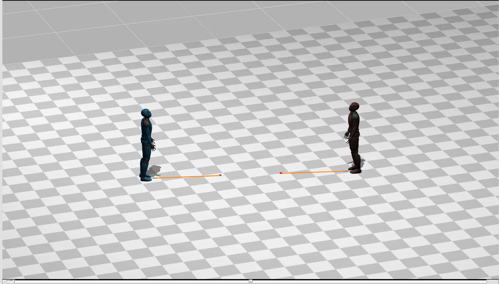
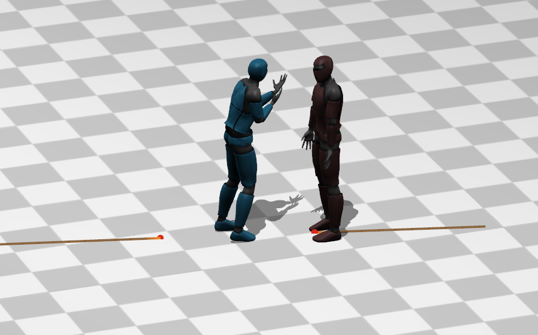
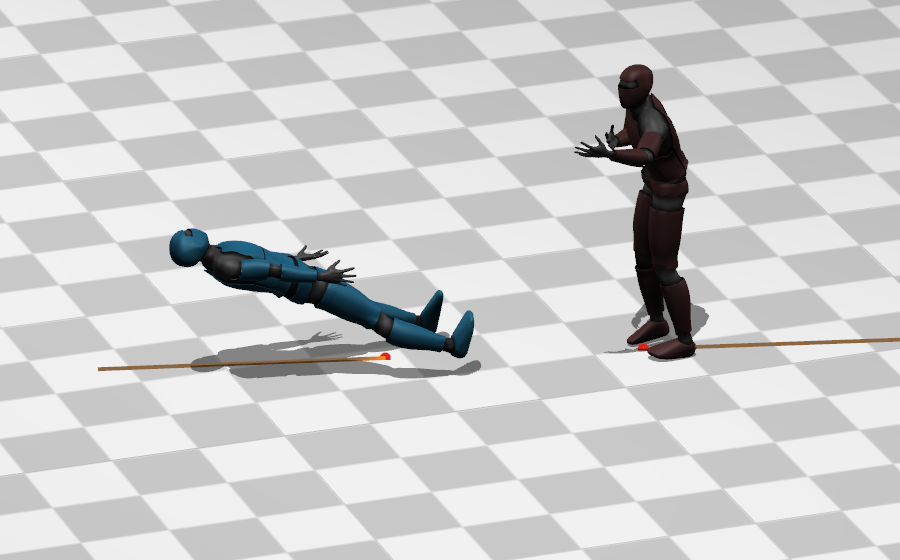
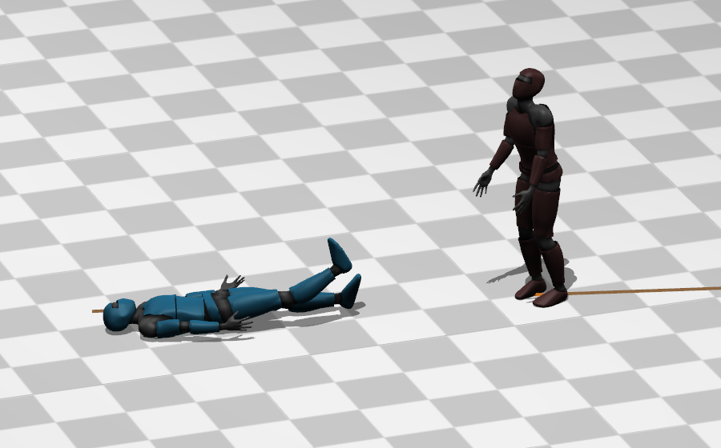
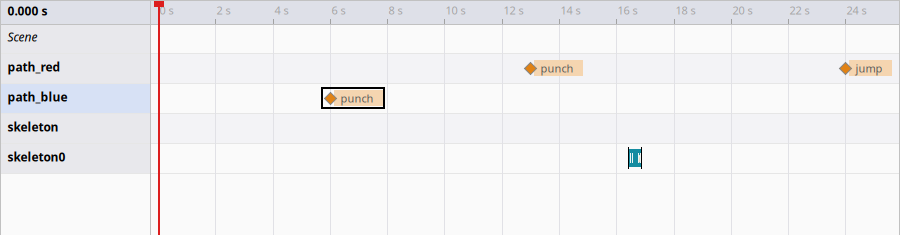
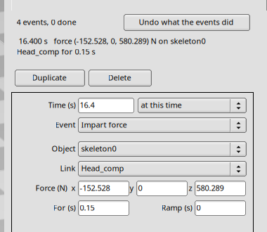

# Stunt Double Tutorial 6: Robot Fight

Nov 17, 2026 · @Ari

## Before you start

In this tutorial two robots, one red and one blue, walk up to each other and trade punches until one knocks the other down. Both are simulated, so their punches really land and shove each other about. You choreograph the fight on the timeline, and stage the knockout as a stunt. It takes about 25 minutes and assumes you have done Tutorial 5 (paths and path events).

1. Load **Scripts > tutorials > Tutorial\_48\_Robot\_Fight**.
2. Wait a few seconds while it loads both robots and their networks. They stand 5 m apart, facing each other, and the **Timeline** window opens.

## 1. The fight

Press **Play** and watch the fight through once. It lasts about 30 s:

| Time | What happens |
| --- | --- |
| 0 to 5 s | They walk toward each other and stop face to face, within arm's reach |
| 6 s | Blue throws a flurry of jabs. Red takes them and staggers |
| 13 s | Red answers with a flurry of its own |
| 16.4 s | One of red's jabs knocks blue flat |
| 24 s | Red jumps for joy |

Stop and Reset to watch it again. Both robots go back to where they started.



*Figure 1. Face to face, before the first punch.*



*Figure 2. Blue's flurry.*



*Figure 3. The knockout: blue goes down.*



*Figure 4. Blue is down; red has jumped for joy.*

## 2. Two characters

Each robot is a complete character of its own, the same as the one in Tutorial 5:

| | Red | Blue |
| --- | --- | --- |
| Skeleton | skeleton | skeleton0 |
| Path (and timeline row) | path\_red | path\_blue |
| Network | neural | neural\_skeleton0 |
| Armour | IndianRed | SteelBlue |

Each has its own motion matching, so each picks its own clips from the motion capture. Each has its own copy of the trained network, so each keeps its own balance. They share one physics world, so they collide.

Each walks along a short straight path toward the middle, drawn by the script. You can see both in orange on the ground. Painting with Shift and the mouse redraws red's path.

The colours are the robots' armour plates. Try another while it is open, from the command window:

```python
dance.geometry("skeleton_robot_armor", "material", "Gold")
```

Any name in **data/materials/stock.txt** works. The dark suit under the plates is **skeleton\_robot\_suit**.

## 3. The fight on the timeline

The whole fight is on the timeline. Each robot's actions are path events on its own row, as in Tutorial 5:

- **path\_red**: punch at 13 s, jump at 24 s;
- **path\_blue**: punch at 6 s;
- **skeleton0** (blue's body): the knockout at 16.4 s, a shove. The next section is about it.



*Figure 5. The fight on the timeline: a row for each robot's actions, and the knockout on blue's.*

A punch is a flurry of about nine jabs over 6 s, at the other's head. To change the fight:

1. Drag a block along its row to have it sooner or later. Leave the 6 s of a flurry clear before that robot's next action, or the next one cuts it short.
2. Click a block and choose another **Action**. Each robot stops, stands still a moment, then does it.
3. Click an empty spot on a row and choose **Path: action (stop, then do it)** to add one. Two flurries at once make a brawl.

The actions are **punch**, **kick**, **jump**, **jump\_forward** and **hop\_turn**. A kick or a forward jump lunges the robot almost a metre forward, straight into the other. Expect a tangle, and often the one who lunged goes down.

## 4. The knockout

The jabs land, but on their own they only rock the other robot. Each network was trained to keep its balance under shoves of up to about 100 N, and it does. So the knockout is a stunt, the way a film fight is: at 16.4 s, as one of red's jabs reaches blue's face, an **Impart force** event shoves blue's head back with 600 N for 0.15 s. Blue can't recover from that and goes down.

1. Click the knockout's block on the **skeleton0** row. The timeline's panel shows it: the link **Head\_comp**, the force's x and z (about 600 N, pointing from red toward blue), and **For (s)** 0.15.
2. Drag it to another moment of red's flurry, or change the force, and play again.
3. Delete it, and they slug it out with nobody going down.



*Figure 6. The knockout's event: a 600 N shove on blue's head for 0.15 s.*

To stage your own, time the shove to a jab that lands. Watch the fight, note when a fist meets a face, and put the shove there. Push the other way to knock red down instead. Use the head for a knockout, or the hips (**Hip**) for a shove that sends a robot staggering back.

## 5. The settings

The fight's settings are at the top of **scripts/tutorials/Tutorial\_48\_Robot\_Fight.py**. Change one, save, and load the script again:

| Setting | Default | What it does |
| --- | --- | --- |
| start | 5.0 m | How far apart they start |
| apart | 0.65 m | How close they aim to stop before fighting, hip to hip (where they really stop varies by a few tenths of a metre) |
| fights | 4 actions | The actions as (time, robot, action): the same events as the timeline's path rows |
| knockout | 16.4 s | When the knockout shove comes (None: no knockout) |
| punch | 600 N | How hard the knockout shove is |

How close they stand changes the fight the most:

- **Closer** (apart 0.55): they stop with their bodies touching, the first flurry tangles them, and both go down.
- **The default** (apart 0.65): the jabs reach the other's face and shove it about, and both stay up.
- **Farther** (apart 0.85): the jabs stop about 0.4 m short of the other's face.

## What next

Everything here can also be typed in the command window while the fight is open:

| Command | What it does |
| --- | --- |
| `dance.generic("timeline", "path", 20.0, "path_blue", "act", "kick")` | Blue kicks at 20 s |
| `dance.generic("timeline", "force", 10.0, "skeleton", "Head_comp", 0, 0, -600, 0.15)` | Shove red's head back at 10 s (-z: away from blue) |
| `walkers[1].act("punch")` | Blue punches now |
| `dance.geometry("skeleton0_robot_armor", "material", "Gold")` | Gold armour for blue |

A third robot takes one line in the script, after the other two:

```python
green = add_walker("path_green", at=(2.0, 2.5), facing=-1.57, policy=red.policy, paint=False, skin="robot")
```

Give it a path (`dance.generic("path_green", "add", x, z)` for each point) and some events on its row.
